# Hands-on Screenshots: Ansible Control Node + 2 Managed Nodes

Screenshots from my run of the [lab](../README.md), in the same order as the lab steps.

## Steps 6–8: Create the 3 servers

**Creating the control node, node1 and node2 (each prints its instance ID)**

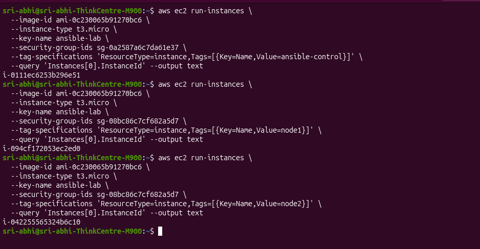

## Step 9: Get the IP addresses

**All 3 running, with private and public IPs**

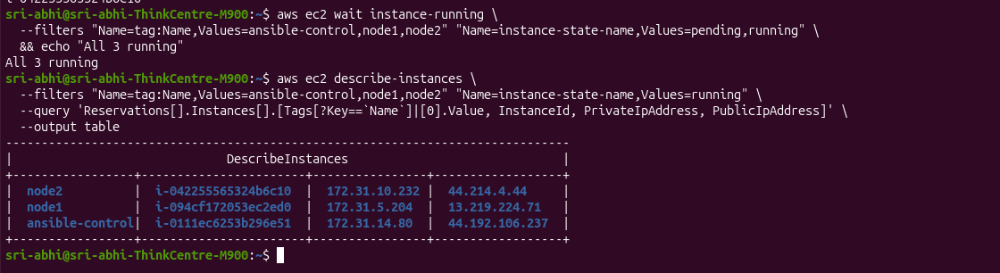

**The same 3 servers in the EC2 console**

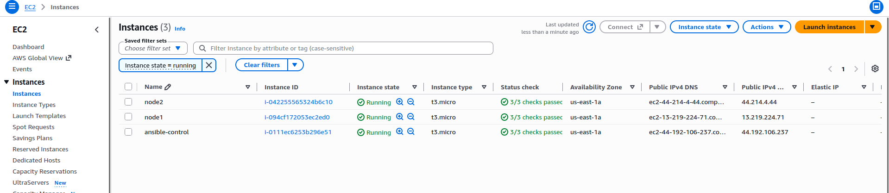

## Step 10: Copy the private key to the control node (on your laptop)

**Key copied to the control node with scp**

## Steps 11–12: Log in and protect the key

**Logged in to the control node, key protected with chmod 400**

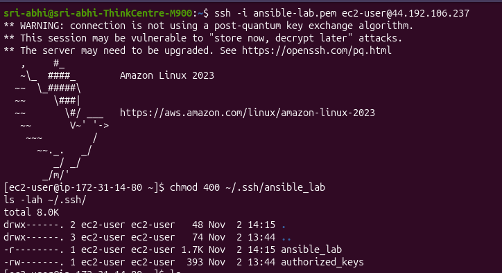

## Step 13: Install Ansible

**ansible-core 2.15.3 installed, config file = None**

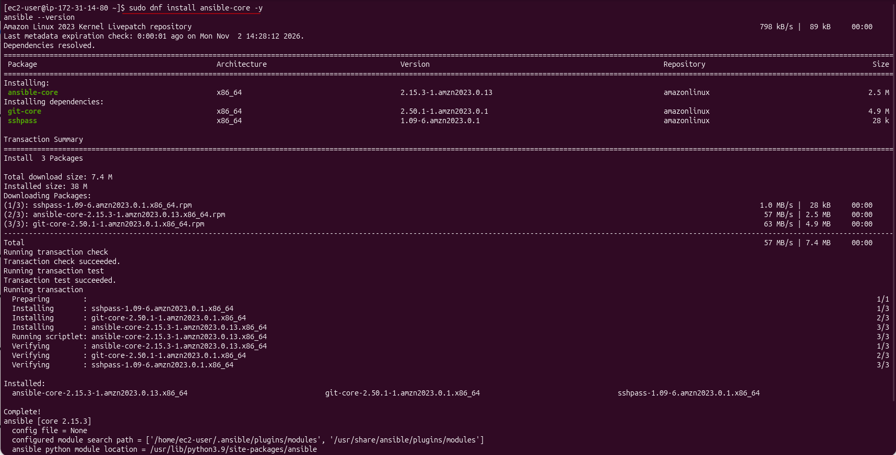

## Steps 18–19: Check the inventory and ping (the long way)

**Inventory graph + ping the long way (note the yellow Python warnings)**

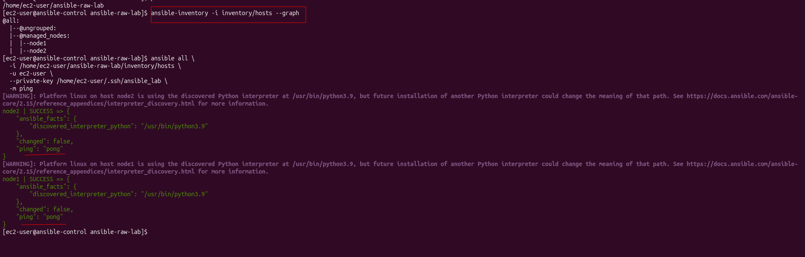

## Step 20: Run two more commands (see the repetition)

**uptime and df -h, typing -i, -u and --private-key every time**

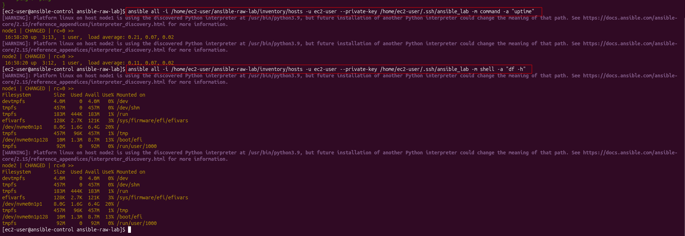

## Step 21: Create `ansible.cfg`

**ansible.cfg in vim**

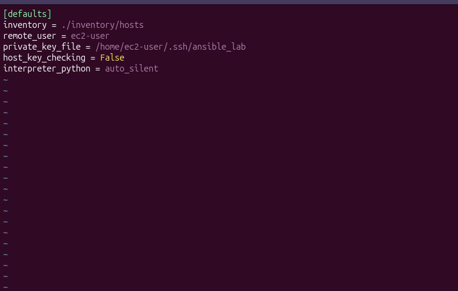

## Step 22: Check Ansible found it

**Key path found with realpath, and Ansible now uses ansible-raw-lab/ansible.cfg**

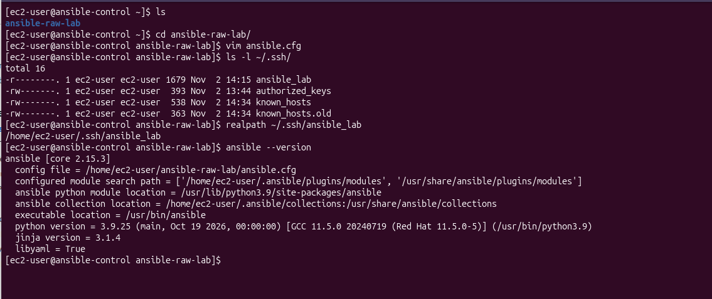

## Step 24: Ping again (the short way)

**Short commands, no warnings**

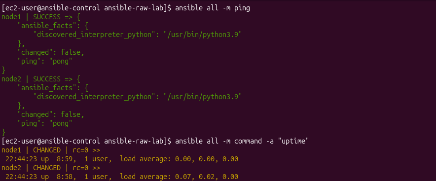

## Step 26: Show that the folder decides which `ansible.cfg` is used

**In ~ → config file = None. In ~/ansible-raw-lab → ansible.cfg found**

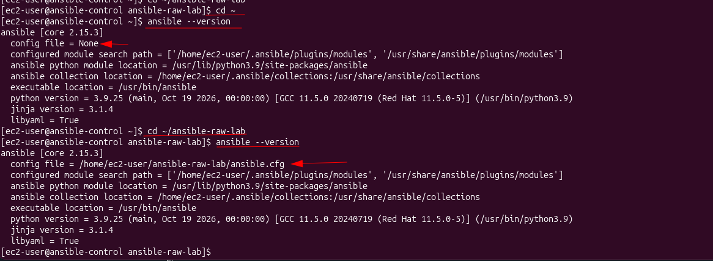

## Step 27: Point Ansible to the config from any folder (temporary)

**export ANSIBLE_CONFIG works from ~**

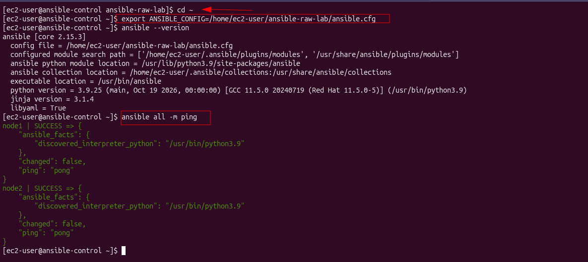

## Step 28: Remove it

**After unset → config file = None again**

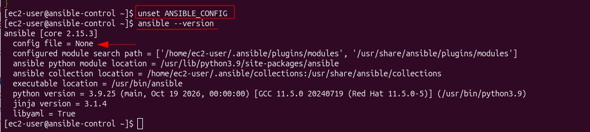

## Steps 29–30: Make it permanent with `.bashrc`, then undo it

**Permanent with .bashrc, then undone**

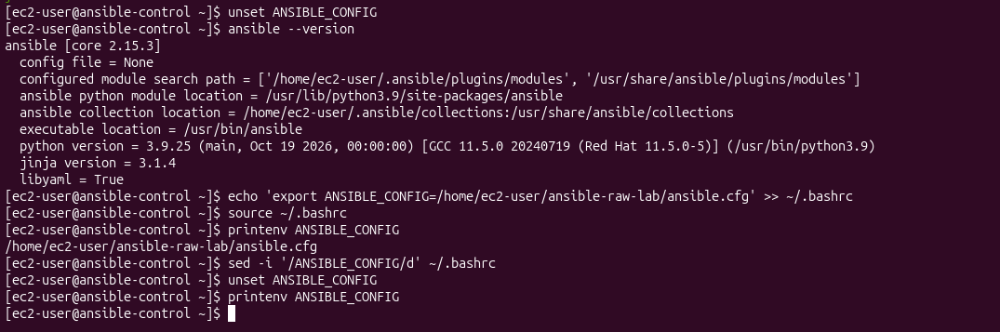

## Step 31: Write the playbook

**The nginx playbook in vim**

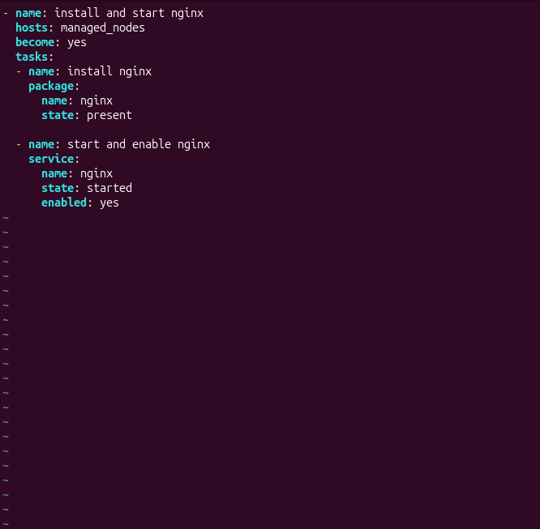

## Step 32: Run the playbook

**Playbook run: changed=2, failed=0 on both nodes**

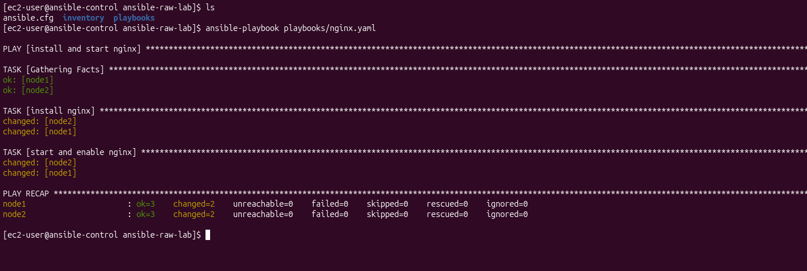

## Step 33: Check nginx

**curl from the control node: 200 OK, Server: nginx**

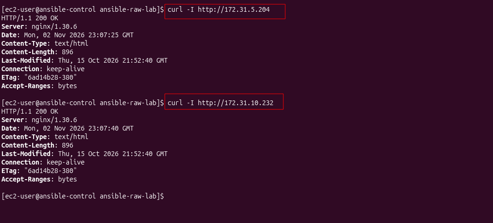

**node1 in the browser**

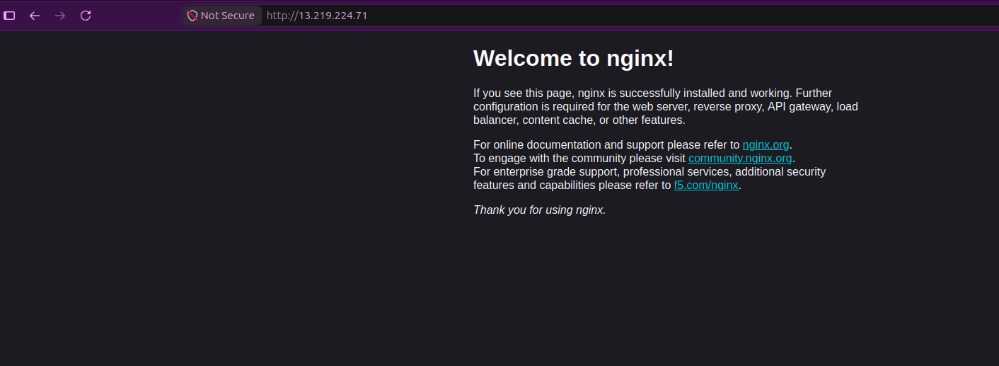

**node2 in the browser**

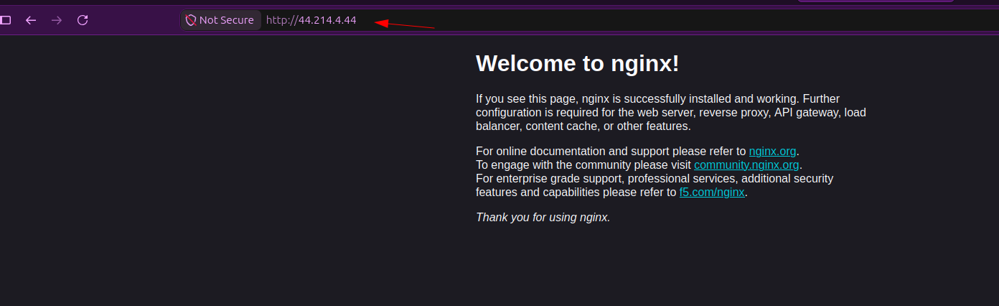

## Step 34: Delete the servers

**All 3 servers terminated**

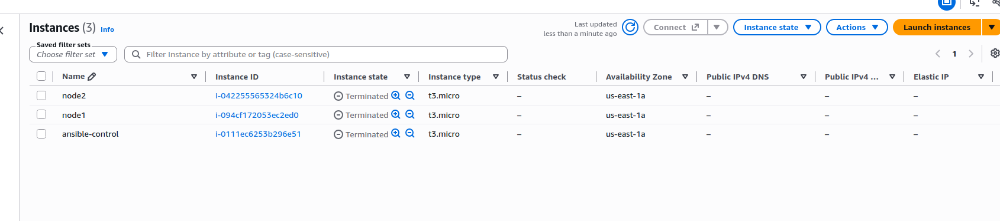
