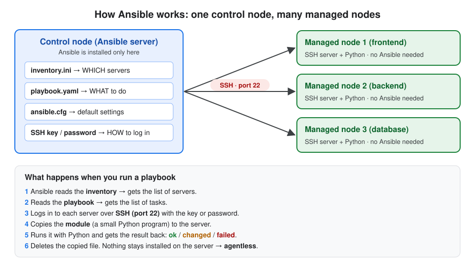
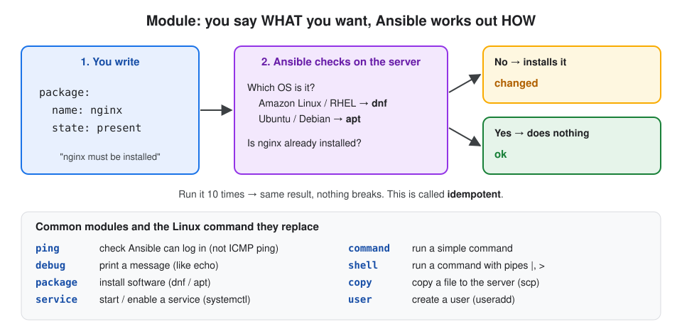
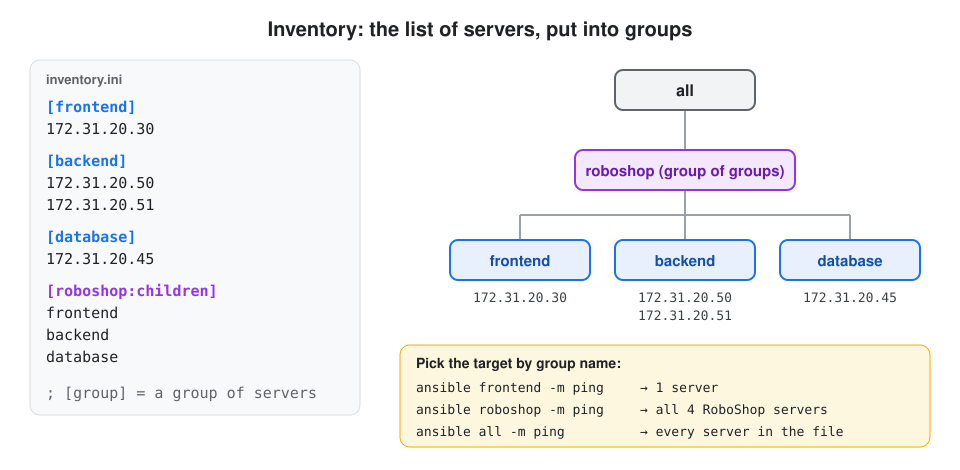
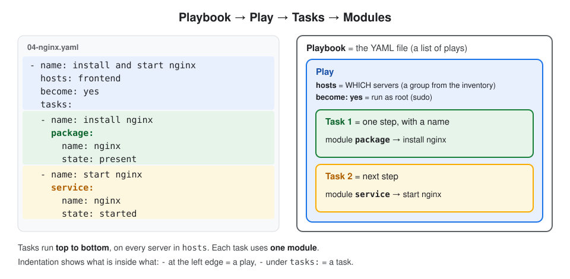
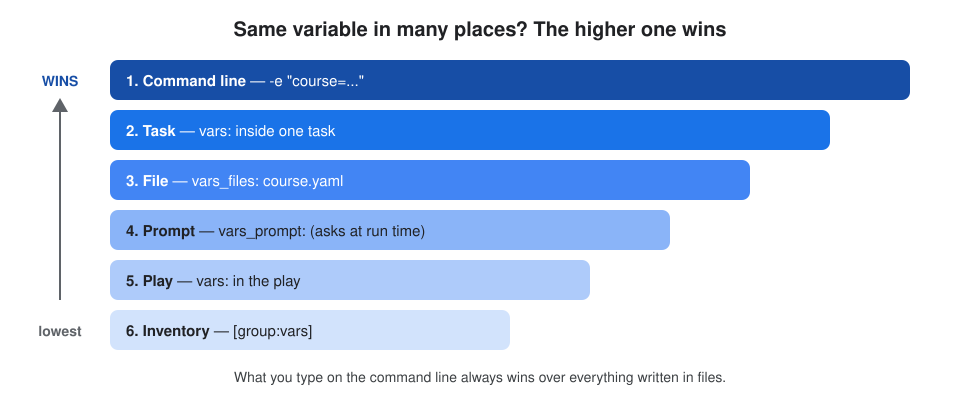

# Day 20 - Ansible Basics: How Ansible Works, Modules, Inventory, Playbooks & Variables

## About this class

In this class we learn the **basics of Ansible**: what it is, how it manages servers, and how to use it in a simple hands-on lab.

**What we cover:**

| Part | Topic |
|---|---|
| **Part 1: Concepts** | what Ansible is · how it connects to managed nodes **over SSH** and runs commands on them · **modules** · **inventory** files · **YAML** · **playbooks** · the Ansible **workflow** and **folder structure** |
| **Part 2: Lab** | security group **inbound rules** · create the **Ansible server** · install Ansible · first playbooks · **multi-play** playbook · create a **managed server** · install **nginx** with a playbook |
| **Part 3: Variables** | the 6 places to define variables · which value wins |

**More in this folder:** [Interview questions](interview-questions/README.md) · **Hands-on lab:** [Control node + managed nodes with SSH keys & ansible.cfg](../ansible-lab-control-node-managed-nodes/README.md)

## Table of Contents

**Part 1: Concepts**
1. [What is Ansible?](#1-what-is-ansible)
2. [How Ansible connects to managed nodes](#2-how-ansible-connects-to-managed-nodes)
3. [Modules](#3-modules)
4. [Inventory](#4-inventory)
5. [YAML](#5-yaml)
6. [Playbooks](#6-playbooks)
7. [Ansible workflow and folder structure](#7-ansible-workflow-and-folder-structure)

**Part 2: Lab**
- [Step 1: Security group inbound rules](#step-1-security-group-inbound-rules)
- [Step 2: Create the Ansible server](#step-2-create-the-ansible-server)
- [Step 3: Install Ansible and get the code](#step-3-install-ansible-and-get-the-code)
- [Step 4: Check the inventory](#step-4-check-the-inventory)
- [Step 5: First playbook (ping)](#step-5-first-playbook-ping)
- [Step 6: Print a message (debug)](#step-6-print-a-message-debug)
- [Step 7: Multi-play playbook](#step-7-multi-play-playbook)
- [Step 8: Create the managed server (frontend)](#step-8-create-the-managed-server-frontend)
- [Step 9: Connect to the frontend over SSH](#step-9-connect-to-the-frontend-over-ssh)
- [Step 10: Install nginx with a playbook](#step-10-install-nginx-with-a-playbook)

**Part 3: Variables**
- [Where variables can be defined](#where-variables-can-be-defined)
- [Which value wins?](#which-value-wins)

[What I learned](#what-i-learned) · [Interview Questions](#interview-questions)

---

# Part 1: Concepts

## 1. What is Ansible?

**Definition:** **Ansible** = a **configuration management** tool. It sets up servers automatically: installs packages, creates users and folders, starts services.

To run any application you need **2 things**:

| # | Part | What it is | Who handles it |
|---|---|---|---|
| 1 | **Code** | the application (Java, Node.js, Python files) | developers, kept in Git |
| 2 | **Configuration** | everything on the server so the code can run: packages, users, folders, services | **Ansible** |

```
plain server ──(Ansible configures it)──► ready server ──(+ code)──► app running
```

**Why not just a shell script?** A script works on one server and one OS, and can break if you run it twice. Ansible works on **many servers at once**, on **any Linux OS**, and is **safe to run again and again**.

## 2. How Ansible connects to managed nodes

**Definition:**
- **Control node** (Ansible server) = the server where Ansible is **installed**. You run all commands from here.
- **Managed node** = a server Ansible **configures**. It only needs **SSH + Python**, no Ansible. That's why Ansible is called **agentless**.



| | Control node | Managed node |
|---|---|---|
| Ansible installed? | ✅ yes | ❌ no |
| What it has | inventory, playbooks, SSH key/password | SSH server + Python |
| Connection | starts SSH (port 22) | accepts SSH (port 22) |

> In one line: **Ansible = SSH + Python + a list of tasks.**

## 3. Modules

**Definition:** **Module** = a small ready-made program that does **one job** on a server: install a package, start a service, copy a file. In Ansible, **everything is done by a module**. A **collection** is a package of modules (for example `ansible.builtin`).



| Linux command | Ansible module |
|---|---|
| `sudo dnf install nginx -y` | `package: name=nginx state=present` |
| `sudo systemctl start nginx` | `service: name=nginx state=started` |
| `sudo systemctl enable nginx` | `service: name=nginx enabled=yes` |
| `echo "hello"` | `debug: msg="hello"` |

**You say WHAT, Ansible works out HOW.** The `package` module checks the OS first, then uses `dnf` on Amazon Linux or `apt` on Ubuntu, and only installs if it's missing.

| Result | Meaning |
|---|---|
| `changed` (yellow) | Ansible had to do something |
| `ok` (green) | already correct, nothing to do |
| `failed` (red) | something went wrong |

**Idempotent** = running the same thing many times gives the same result. The second run just says `ok`.

## 4. Inventory

**Definition:** **Inventory** = a file that lists the **servers Ansible manages**, put into **groups**. Usually called `inventory.ini`.



```ini
[frontend]
172.31.20.30

[backend]
172.31.20.50
172.31.20.51

[database]
172.31.20.45

[roboshop:children]
frontend
backend
database

[local]
localhost
```

| Part | Means |
|---|---|
| `[frontend]` | a **group** called frontend, with its server IPs below |
| `[roboshop:children]` | a **group of groups**: roboshop = frontend + backend + database |
| `[local]` + `localhost` | the Ansible server itself |
| `;` | a comment |

**Target a group** by putting its name in the command:

| Command | Runs on |
|---|---|
| `ansible frontend -i inventory.ini -m ping` | only the frontend server |
| `ansible roboshop -i inventory.ini -m ping` | all RoboShop servers |
| `ansible all -i inventory.ini -m ping` | every server in the file |

## 5. YAML

**Definition:** **YAML** = a simple text format for data. It uses **`key: value`** pairs, **indentation (spaces)** to show what's inside what, and **`-`** to start a list item. Playbooks are written in YAML.

**Only 2 shapes to know:**

| Shape | Meaning | YAML | JSON (same data) |
|---|---|---|---|
| **Map** | named fields | `OS: Linux`<br>`CM: ansible` | `{"OS": "Linux", "CM": "ansible"}` |
| **List** | items in order | `- Linux`<br>`- Ansible` | `["Linux", "Ansible"]` |

**Example: a student in YAML** (`student.yaml`)

```yaml
firstName: Sivakumar          # map: key: value
lastName: M
addresses:                    # list of 2 addresses (each starts with -)
  - type: permanent
    city: Hyderabad
  - type: temporary
    city: Hyderabad
skills:                       # map inside a map (no -)
  OS: Linux
  CM: ansible
```

**The same student in JSON** (`student.json`):

```json
{
  "firstName": "Sivakumar",
  "lastName": "M",
  "addresses": [
    { "type": "permanent", "city": "Hyderabad" },
    { "type": "temporary", "city": "Hyderabad" }
  ],
  "skills": { "OS": "Linux", "CM": "ansible" }
}
```

| | XML | JSON | YAML |
|---|---|---|---|
| Looks like | `<city>Hyderabad</city>` | `{"city": "Hyderabad"}` | `city: Hyderabad` |
| Comments | `<!-- -->` | ❌ none | `#` |
| Length | longest | medium | **shortest** |
| Used in | Maven `pom.xml` | APIs, AWS CLI output | **Ansible**, Kubernetes, GitHub Actions |

**YAML rules:**

| Rule | Example |
|---|---|
| space after `:` | `city: Hyderabad` ✅, `city:Hyderabad` ❌ |
| indent with **spaces only**, never tabs | 2 spaces |
| same level = same indentation | `firstName` and `lastName` start in the same column |
| `-` = list item | `- type: permanent` |
| `#` = comment | `# list of addresses` |
| no commas at the end of lines | `city: Hyderabad,` makes the comma part of the value |

> **Tip:** paste your YAML into **[yamlchecker.com](https://yamlchecker.com)** before running it. It shows the line with a wrong space or tab.

## 6. Playbooks

**Definition:** **Playbook** = a YAML file that tells Ansible **which servers** to work on and **what tasks** to run on them, in order.



| Word | Meaning |
|---|---|
| **Playbook** | the `.yaml` file |
| **Play** | one block in it: `name` + `hosts` (which servers) + `tasks` |
| **Task** | one step, with a `name` |
| **Module** | what the task actually does (`package`, `service`, `debug`, ...) |

| Keyword | Means |
|---|---|
| `hosts: frontend` | run on the `[frontend]` group from the inventory |
| `become: yes` | run as **root** (sudo) |
| `connection: local` | run on the Ansible server itself, **no SSH** |

## 7. Ansible workflow and folder structure

**Definition:** **Workflow** = the order of steps from writing the files to a configured server.

```
1. Write the inventory   (WHICH servers)        inventory.ini
          │
2. Write the playbook    (WHAT to do)           04-nginx.yaml
          │
3. Run it                ansible-playbook -i inventory.ini 04-nginx.yaml
          │
4. Ansible logs in over SSH to each server, runs the modules
          │
5. Read the result       PLAY RECAP: ok / changed / failed
```

**Folder structure** of the class code repo (`ansible-code`):

```
ansible-code/
├── inventory.ini              ← the servers (groups)
├── 01-playbook.yaml           ← ping the Ansible server
├── 02-playbook.yaml           ← print a message (debug)
├── 03-multi-play.yaml         ← two plays in one file
├── 04-nginx.yaml              ← install + start nginx on frontend
├── 05-variables.yaml  ...  11-vars-preference.yaml   ← variables
├── course.yaml                ← variables file (used by vars_files)
└── student.xml / student.json / student.yaml   ← data format examples
```

> Everything is kept in **Git**: change a playbook on your laptop, `git push`, then `git pull` on the Ansible server and run it.

---

# Part 2: Lab

```
Step 1  security group (22, 80)
Step 2  create Ansible server ──► Step 3 install Ansible ──► Steps 4–7 inventory + first playbooks (local)
Step 8  create frontend server ──► Step 9 SSH check ──► Step 10 nginx playbook
```

### Step 1: Security group inbound rules

**Definition:** **Inbound rule** = a security group (firewall) rule that **allows traffic into** a server on a port.

We use one security group, **`roboshop-common`**, on **both** servers. It needs these inbound rules:

| Port | Protocol | Why |
|---|---|---|
| **22** | SSH | you log in to the Ansible server, and the Ansible server logs in to the frontend |
| **80** | HTTP | to open the nginx page in a browser (only for viewing; Ansible doesn't use it) |

Add port 22:

```bash
aws ec2 authorize-security-group-ingress --group-name roboshop-common --protocol tcp --port 22 --cidr 0.0.0.0/0
```

Add port 80:

```bash
aws ec2 authorize-security-group-ingress --group-name roboshop-common --protocol tcp --port 80 --cidr 0.0.0.0/0
```

**What it does:** `authorize-security-group-ingress` adds an **inbound** rule. `--cidr 0.0.0.0/0` = from anywhere.
**Expected:** `"Return": true`. If you see `InvalidPermission.Duplicate`, the rule already exists, which is fine.

> **No outbound rules needed:** security groups allow all outbound traffic by default, and they are **stateful** (replies to allowed traffic are let back in automatically).

### Step 2: Create the Ansible server

**Definition:** **`aws ec2 run-instances`** = the AWS CLI command that **creates** an EC2 server.

```bash
aws ec2 run-instances \
    --image-id ami-0055977a6e828a4f4 \
    --instance-type t3.micro \
    --security-groups "roboshop-common" \
    --tag-specifications 'ResourceType=instance,Tags=[{Key=Name,Value=ansible-server}]' \
    --query 'Instances[0].InstanceId' \
    --output text
```

| Option | Means |
|---|---|
| `--image-id` | which OS image (AMI) to use |
| `--instance-type t3.micro` | size of the server (CPU/RAM) |
| `--security-groups "roboshop-common"` | the security group from Step 1 |
| `--tag-specifications ... Value=ansible-server` | gives the server the name `ansible-server` |
| `--query 'Instances[0].InstanceId'` | from the big output, print only the **instance ID** |
| `--output text` | print it as plain text |

**Expected:** only the ID, e.g. `i-0abc123...`

### Step 3: Install Ansible and get the code

Log in to the Ansible server:

```bash
ssh ec2-user@<ansible-server-public-ip>
```

Install Ansible:

```bash
sudo dnf install ansible -y
```

Check it:

```bash
ansible --version
```

**Expected:** `ansible [core 2.x.x]`

Get the class code:

```bash
git clone https://github.com/Abhignadumpala/ansible-code.git
```

```bash
cd ansible-code
```

### Step 4: Check the inventory

```bash
ansible-inventory -i inventory.ini --graph
```

**What it does:** shows all groups and servers as a tree. It only **reads the file**; it doesn't connect to anything.

**Expected** (short):

```
@all:
  |--@ungrouped:
  |--@roboshop:
  |  |--@frontend:
  |  |  |--172.31.20.30
  |  |--@backend:
  |  |--@database:
  |--@local:
  |  |--localhost
```

`@` = a group. `@all` = every server. `@ungrouped` = servers written without a group.

### Step 5: First playbook (ping)

`01-playbook.yaml`:

```yaml
- name: ping demo
  hosts: local
  connection: local
  tasks:
  - name: ping localhost
    ping:
```

| Line | Means |
|---|---|
| `- name: ping demo` | start of a **play**, with a label shown in the output |
| `hosts: local` | run on the `[local]` group (the Ansible server itself) |
| `connection: local` | run directly here, **no SSH**, so no username/password needed |
| `ping:` | the module: checks Ansible can run here, answers `pong` |

```bash
ansible-playbook -i inventory.ini 01-playbook.yaml
```

**What it does:** `ansible-playbook` runs a playbook. `-i` tells it where the inventory is.
**Expected:** `ok: [localhost]` and `PLAY RECAP ... ok=2 changed=0 failed=0`

### Step 6: Print a message (debug)

`02-playbook.yaml`:

```yaml
- name: demo on debug
  hosts: local
  connection: local
  tasks:
  - name: print hello world
    ansible.builtin.debug:
      msg: "Hello Ansible..!"
```

`debug` prints a message, like `echo`. `ansible.builtin.` is the collection it comes from; just `debug:` also works.

```bash
ansible-playbook -i inventory.ini 02-playbook.yaml
```

**Expected:**

```
PLAY [demo on debug] ***********************************************

TASK [Gathering Facts] *********************************************
ok: [localhost]

TASK [print hello world] *******************************************
ok: [localhost] =>
  msg: Hello Ansible..!

PLAY RECAP *********************************************************
localhost : ok=2  changed=0  unreachable=0  failed=0  skipped=0
```

| Output | Means |
|---|---|
| `PLAY [...]` | the play's `name` |
| `TASK [Gathering Facts]` | Ansible first collects info about the server (OS, IP...), automatically |
| `TASK [print hello world]` | your task's `name` |
| `PLAY RECAP` | summary per server: how many `ok`, `changed`, `failed` |

### Step 7: Multi-play playbook

**Definition:** **Multi-play playbook** = one playbook with **more than one play**. Plays run **top to bottom**, and each play can target **different servers**.

`03-multi-play.yaml`:

```yaml
- name: PLAY-1
  hosts: local
  connection: local
  tasks:
  - name: PLAY-1 and TASK-1
    debug:
      msg: "Hello from PLAY-1 TASK-1"
  - name: PLAY-1 and TASK-2
    debug:
      msg: "Hello from PLAY-1 TASK-2"

- name: PLAY-2
  hosts: local
  connection: local
  tasks:
  - name: PLAY-2 and TASK-1
    debug:
      msg: "Hello from PLAY-2 TASK-1"
  - name: PLAY-2 and TASK-2
    debug:
      msg: "Hello from PLAY-2 TASK-2"
```

> `-` at the **left edge** = a new **play**. `-` under `tasks:` = a new **task**.

```bash
ansible-playbook -i inventory.ini 03-multi-play.yaml
```

**Expected order:** PLAY-1 TASK-1 → PLAY-1 TASK-2 → PLAY-2 TASK-1 → PLAY-2 TASK-2, and `ok=6` (2 plays × (Gathering Facts + 2 tasks)).

**Real use:** set up servers in the right order with one command:

```yaml
- name: set up database
  hosts: database
  ...
- name: set up backend
  hosts: backend
  ...
- name: set up frontend
  hosts: frontend
  ...
```

### Step 8: Create the managed server (frontend)

**Definition:** the **frontend** server is our **managed node**: Ansible connects to it over SSH and configures it.

Same command as Step 2, only the name changes:

```bash
aws ec2 run-instances \
    --image-id ami-0055977a6e828a4f4 \
    --instance-type t3.micro \
    --security-groups "roboshop-common" \
    --tag-specifications 'ResourceType=instance,Tags=[{Key=Name,Value=roboshop-frontend}]' \
    --query 'Instances[0].InstanceId' \
    --output text
```

Get its **private IP** (the Ansible server talks to it inside AWS):

```bash
aws ec2 describe-instances --instance-ids <instance-id> --query 'Reservations[0].Instances[0].PrivateIpAddress' --output text
```

| | Ansible server | Frontend server |
|---|---|---|
| Name | `ansible-server` | `roboshop-frontend` |
| Role | control node | managed node |
| Ansible installed? | ✅ yes | ❌ no |
| Security group | `roboshop-common` | `roboshop-common` |

### Step 9: Connect to the frontend over SSH

On the Ansible server, put the frontend's private IP under `[frontend]` in `inventory.ini`:

```ini
[frontend]
172.31.20.30
```

Check that Ansible can log in to it:

```bash
ansible frontend -i inventory.ini -e ansible_user=ec2-user -e ansible_password=<password> -m ping
```

**What it does:** Ansible connects to the frontend over **SSH (port 22)** with the username and password passed with `-e`, then runs the `ping` module there.
**Expected:** `172.31.20.30 | SUCCESS => { "ping": "pong" }`

```
ansible-server ── SSH (port 22, private IP) ──► roboshop-frontend
 (control node)                                  (managed node)
```

### Step 10: Install nginx with a playbook

`04-nginx.yaml`:

```yaml
- name: install and start nginx
  hosts: frontend
  become: yes
  tasks:
  - name: install nginx
    package:
      name: nginx
      state: present

  - name: start nginx
    service:
      name: nginx
      state: started
      enabled: yes
```

| Line | Means |
|---|---|
| `hosts: frontend` | run on the `[frontend]` group, over **SSH** (no `connection: local`) |
| `become: yes` | run as **root**; installing software needs root |
| `package:` `state: present` | nginx must be **installed** (uses `dnf` or `apt` automatically) |
| `service:` `state: started` | nginx must be **running** now |
| `enabled: yes` | nginx must **start on every boot** |

```bash
ansible-playbook -i inventory.ini -e ansible_user=ec2-user -e ansible_password=<password> 04-nginx.yaml
```

**Expected:**

| Run | Result | Why |
|---|---|---|
| 1st run | `changed` for both tasks | nginx was installed and started |
| 2nd run | `ok`, `changed=0` | already done (**idempotent**) |

**Check nginx:**

| Where | Command | Expected |
|---|---|---|
| Browser | `http://<frontend-public-ip>` | nginx welcome page |
| Terminal | `curl -I http://<frontend-public-ip>` | `HTTP/1.1 200 OK` |

**If the page doesn't open:**

| Symptom | Cause | Fix |
|---|---|---|
| browser keeps loading, then **timed out** | port 80 not allowed | add the port 80 rule (Step 1) |
| **connection refused** | nginx not running | run the playbook again |
| wrong page | wrong IP | use the **frontend's** public IP, not the Ansible server's |

---

# Part 3: Variables

**Definition:** **Variable** = a **name** that stores a **value**. Write the value once, use it in many places with **`{{ name }}`**.

| Shell | Ansible |
|---|---|
| `COURSE="ansible"` | `course: ansible` under `vars:` |
| `echo "$COURSE"` | `msg: "{{ course }}"` |

## Where variables can be defined

| # | Where | Keyword | File |
|---|---|---|---|
| 1 | in the **play** | `vars:` | `05-variables.yaml` |
| 2 | in a **task** | `vars:` under a task | `06-variables.yaml` |
| 3 | in a **separate file** | `vars_files:` | `07-variables.yaml` + `course.yaml` |
| 4 | **asked at run time** | `vars_prompt:` | `08-variables.yaml` |
| 5 | in the **inventory** | `[group:vars]` | `09-variables.yaml` |
| 6 | on the **command line** | `-e "name=value"` | `10-variables.yaml` |

### 1. Play variables (05-variables.yaml)

**Definition:** variables under `vars:` in the **play**. Every task in that play can use them.

```yaml
- name: demo on variables
  hosts: local
  connection: local
  vars:
    course: ansible
    trainer: Sivakumar Reddy M
    duration: 10 hrs
  tasks:
  - name: print the vars
    debug:
      msg: "Hi, I am learning {{ course }} from {{ trainer }}, duration is {{ duration }}"
```

**Expected:** `Hi, I am learning ansible from Sivakumar Reddy M, duration is 10 hrs`

### 2. Task variables (06-variables.yaml)

**Definition:** variables under `vars:` **inside one task**. They work only in that task and **win over** play variables with the same name.

```yaml
- name: demo on task level variables
  hosts: local
  connection: local
  vars:
    property: "100acres"          # play level
  tasks:
  - name: print the vars
    debug:
      msg: "Hi, I got {{ property }} from my father"

  - name: print the vars again
    vars:
      property: "10acres"         # task level
    debug:
      msg: "Hi, I got {{ property }} from my father"
```

| Task | Prints | Why |
|---|---|---|
| print the vars | `100acres` | no task variable, so it uses the play variable |
| print the vars again | `10acres` | the task's own variable wins |

### 3. Variables from a file (07-variables.yaml)

**Definition:** **`vars_files`** = load variables from a separate YAML file, so you can change values without touching the playbook.

`course.yaml`:

```yaml
course: ansible from file
trainer: Sivakumar Reddy M
duration: 10 hrs
```

`07-variables.yaml`:

```yaml
- name: variables from files
  hosts: local
  connection: local
  vars_files:
  - course.yaml
  tasks:
  - name: print course information
    debug:
      msg: "Hi, I am learning {{ course }} from {{ trainer }}, duration is {{ duration }}"
```

### 4. Variables from a prompt (08-variables.yaml)

**Definition:** **`vars_prompt`** = Ansible **asks you** to type the value when the playbook runs. Good for passwords you don't want to save in files.

```yaml
- name: variables from prompt
  hosts: local
  connection: local
  vars_prompt:
  - name: username
    prompt: Please enter your username
    private: false                # you see what you type
  - name: password
    prompt: Please enter your password
    private: true                 # typing is hidden
  tasks:
  - name: print the information
    debug:
      msg: "username is: {{ username }}"
```

> ⚠️ Never print passwords in real projects.

### 5. Variables from the inventory (09-variables.yaml)

**Definition:** variables under **`[group:vars]`** in `inventory.ini`. Every server in that group gets them automatically.

```ini
[frontend]
172.31.20.30

[frontend:vars]
course=ansible
trainer=Sivakumar Reddy M
duration=10 hrs
```

```yaml
- name: variables from inventory
  hosts: frontend
  tasks:
  - name: print the variables
    debug:
      msg: "Hi, I am learning {{ course }} from {{ trainer }}, duration is {{ duration }}"
```

```bash
ansible-playbook -i inventory.ini -e ansible_user=ec2-user -e ansible_password=<password> 09-variables.yaml
```

### 6. Variables from the command line (10-variables.yaml)

**Definition:** **`-e`** (extra vars) = pass a value **when you run** the playbook.

```yaml
- name: print greeting
  hosts: local
  connection: local
  tasks:
  - name: print greeting
    debug:
      msg: "Hello {{ person_name }}"
```

| Run | Result |
|---|---|
| `ansible-playbook -i inventory.ini 10-variables.yaml` | ❌ `'person_name' is undefined` |
| `ansible-playbook -i inventory.ini 10-variables.yaml -e "person_name=Sivakumar"` | ✅ `Hello Sivakumar` |

> Every `{{ variable }}` must be defined somewhere, otherwise the playbook **fails**.

**Values with spaces need inner quotes:**

| Command | Prints |
|---|---|
| `-e "course=ansible from cmd"` | `ansible` ❌ (stops at the first space) |
| `-e "course='ansible from cmd'"` | `ansible from cmd` ✅ |

## Which value wins?

**Definition:** **Variable precedence** = when the **same variable name** is defined in many places, Ansible uses the one with the **highest priority**.



```
command line  >  task  >  file  >  prompt  >  play  >  inventory
   (wins)                                              (lowest)
```

**How we tested it** (`11-vars-preference.yaml` defines `course` in every place): run it, remove the winner, run again. The next one in the list wins each time.

| Run | Prints | Winner |
|---|---|---|
| with `-e "course='ansible from cmd'"` | `ansible from cmd` | command line |
| without `-e` | `ansible from task` | task |
| task `vars:` commented out | `ansible from file` | file |

> **The command line always wins.** What you pass at run time overrides everything in files.

---

## What I learned

**Concepts**
- **Ansible** configures servers: packages, users, services. The app **code** comes separately.
- **Control node** has Ansible; **managed nodes** only need **SSH + Python** (agentless).
- **Module** = one job (`ping`, `debug`, `package`, `service`). You say **what**; Ansible works out **how**. `ok` = already correct, `changed` = fixed, safe to run twice (**idempotent**).
- **Inventory** = which servers, in groups. **Playbook** → plays (`hosts`) → tasks → modules, written in **YAML** (`key: value`, `-` = list, spaces not tabs).
- **Workflow:** inventory + playbook → `ansible-playbook` → SSH → modules → PLAY RECAP.

**Lab**
- `roboshop-common` SG: inbound **22** (SSH) and **80** (HTTP).
- Created the Ansible server and the frontend with `aws ec2 run-instances`; installed Ansible; cloned the code.
- Ran `01`–`03` on the Ansible server itself (`connection: local`), then `04-nginx.yaml` on the frontend over SSH with `become: yes`.

**Variables**
- `{{ name }}`, defined in 6 places. Priority: **command line > task > file > prompt > play > inventory**.

```
inventory (WHICH servers) ──┐
                            ├──► ansible-playbook ──SSH──► servers configured
playbook (WHAT to do) ──────┘
```

## Interview Questions

See [interview-questions/README.md](interview-questions/README.md).
