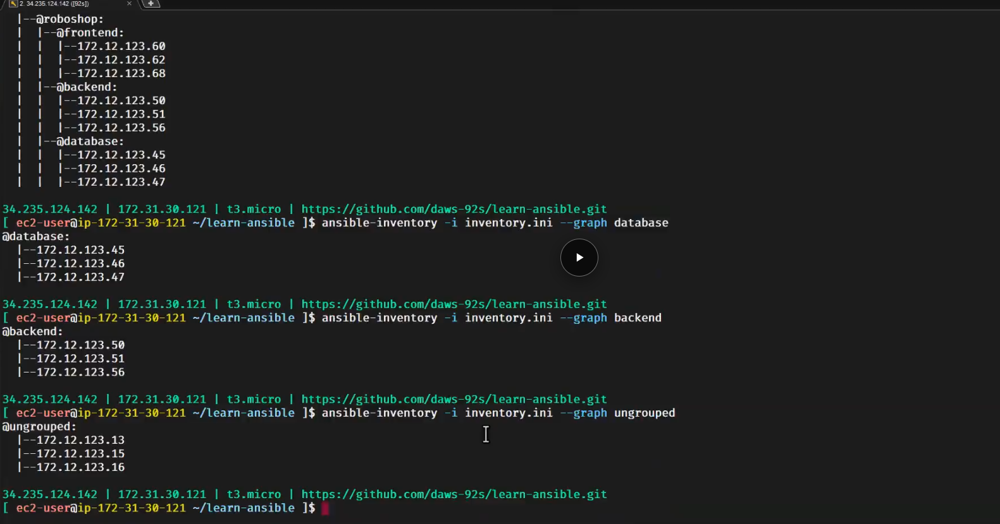
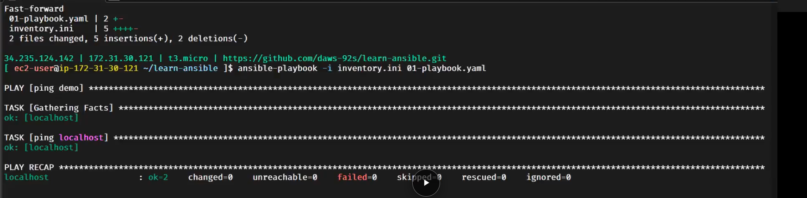
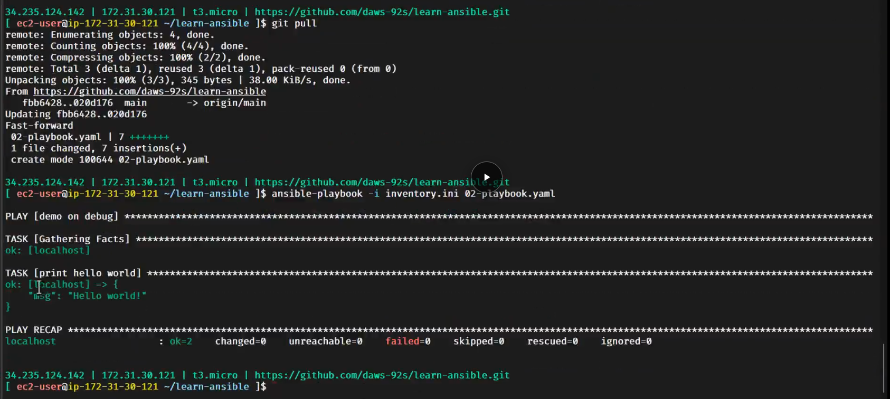

# Day 20 - Ansible Setup: Create the Server, Data Formats (XML, JSON, YAML) & Variables

> **In short:** Running an app needs two things: the **code** and the **configuration** of the server. Ansible does the configuration. We create servers with the **AWS CLI**, tell Ansible which machines to target in the **inventory**, and in Ansible **everything is a module** (or a collection of modules). Playbooks are written in **YAML**, so we compared the same student details written in **XML**, **JSON** and **YAML**: `[]` is a **list**, `{}` is a **map/object**. Ansible also has programming basics: variables, data types, conditions, loops, functions and error handling, starting with **variables**.

**More in this folder:** [Interview questions](interview-questions/README.md)

## Table of Contents

1. [Code vs configuration](#code-vs-configuration)
2. [Create the Ansible server with AWS CLI](#create-the-ansible-server-with-aws-cli)
3. [Ansible: everything is a module](#ansible-everything-is-a-module)
4. [Inventory: the machines Ansible targets](#inventory-the-machines-ansible-targets)
5. [DTO and data formats](#dto-and-data-formats)
   - [List `[]` and map `{}`](#list--and-map-)
   - [Student details in XML](#student-details-in-xml)
   - [Student details in JSON](#student-details-in-json)
   - [Student details in YAML](#student-details-in-yaml)
   - [XML vs JSON vs YAML](#xml-vs-json-vs-yaml)
   - [Check your YAML: yamlchecker.com](#check-your-yaml-yamlcheckercom)
6. [Ansible installation and checking the inventory](#ansible-installation-and-checking-the-inventory)
7. [First playbooks](#first-playbooks)
   - [01-playbook.yaml: ping the Ansible server itself](#01-playbookyaml-ping-the-ansible-server-itself)
   - [02-playbook.yaml: print a message (debug)](#02-playbookyaml-print-a-message-debug)
   - [03-multi-play.yaml: many plays in one playbook](#03-multi-playyaml-many-plays-in-one-playbook)
   - [Run a playbook](#run-a-playbook)
8. [Create the frontend server (managed node)](#create-the-frontend-server-managed-node)
9. [Ansible as a programming language](#ansible-as-a-programming-language)
10. [Variables](#variables)
11. [What I learned](#what-i-learned)
12. [Interview Questions](#interview-questions)

---

## Code vs configuration

**Definition:** To run an application we need **2 things**:

| # | Part | What it is | Who handles it |
|---|---|---|---|
| 1 | **Code** | the application itself (Node.js, Java, Python files) | developers, kept in Git |
| 2 | **Configuration** | everything on the server so the code can run: packages, users, folders, service files | **Ansible** (configuration management) |

```
plain server ──(configuration: Ansible)──► ready server ──(+ code)──► app running
```

## Create the Ansible server with AWS CLI

**Definition:** **`aws ec2 run-instances`** = AWS CLI command that **creates** (launches) an EC2 instance.

First we create the **Ansible server** (control node), where Ansible will be installed.

```bash
aws ec2 run-instances \
    --image-id ami-0055977a6e828a4f4 \
    --instance-type t3.micro \
    --security-groups "roboshop-common" \
    --tag-specifications 'ResourceType=instance,Tags=[{Key=Name,Value=ansible-server}]' \
    --query 'Instances[0].InstanceId' \
    --output text
```

| Option | Means |
|---|---|
| `--image-id ami-...` | which **AMI** (OS image) to use |
| `--instance-type t3.micro` | size of the server (CPU/RAM) |
| `--security-groups "roboshop-common"` | security group (firewall) **by name** |
| `--tag-specifications ... Value=ansible-server` | gives the server the **Name** tag `ansible-server` |
| `--query 'Instances[0].InstanceId'` | from the big JSON output, pick only the **instance ID** of the first instance |
| `--output text` | print it as plain text (no JSON) |

Output: just the ID, e.g. `i-0abc123...`. Easy to use in scripts.

> `Instances[0]` → `Instances` is a **list** `[]`, `[0]` = the **first** item. Same idea as lists in JSON/YAML below.

## Ansible: everything is a module

**Definition:** In Ansible, **everything is a module or a collection**. A **module** = one unit of work (like a Linux command). A **collection** = a package of modules.

| Linux | Ansible |
|---|---|
| `dnf install nginx` (a **command**) | `dnf` **module**: `name: nginx`, `state: installed` |
| `ping` | `ping` **module** |
| many commands | a **collection** of modules (e.g. `ansible.builtin`) |

## Inventory: the machines Ansible targets

**Definition:** **Inventory** = the list of **machines Ansible is targeting** (IPs or hostnames), usually in a file like `inventory.ini`.

```ini
; orphans: IPs at the top, not in any group
172.12.123.13
172.12.123.15
172.12.123.16

[database]
172.12.123.45
172.12.123.46
172.12.123.47

[backend]
172.12.123.50
172.12.123.51
172.12.123.56

[frontend]
172.31.20.30

; group of groups
[roboshop:children]
frontend
backend
database

[local]
localhost

[frontend:vars]
course=ansible
trainer=Sivakumar Reddy M
duration=10 hrs
```

| Part | Means |
|---|---|
| IPs at the top (no `[group]` above them) | **orphans**: we don't know which group they belong to, so they are written at the **top** (Ansible calls them `ungrouped`) |
| `[database]` | **group**: all DB server IPs go here |
| `[backend]` | **group**: all backend server IPs |
| `[frontend]` | **group**: frontend server IP |
| `[roboshop:children]` | **group of groups**: all RoboShop servers = `frontend` + `backend` + `database` |
| `[local]` | group with `localhost` (the Ansible server itself) |
| `[frontend:vars]` | **variables** for every server in the `frontend` group |
| `;` | comment in an `.ini` file |

```
                 roboshop  (group of groups)
        ┌───────────┼────────────┐
    frontend     backend      database
   172.31.20.30  .50 .51 .56  .45 .46 .47

  orphans (ungrouped): .13 .15 .16
```

**Target what you need:**

| Command | Runs on |
|---|---|
| `ansible database -i inventory.ini -m ping` | only the 3 DB servers |
| `ansible backend -i inventory.ini -m ping` | only the 3 backend servers |
| `ansible roboshop -i inventory.ini -m ping` | **all RoboShop servers** (frontend + backend + database) |
| `ansible ungrouped -i inventory.ini -m ping` | only the orphans |
| `ansible all -i inventory.ini -m ping` | **every** server in the file |

## DTO and data formats

**Definition:** **DTO (Data Transfer Object)** = an object used only to **carry data** between systems (e.g. app → API → server). XML, JSON and YAML are formats to write that data.

Same student details, written 3 ways.

### List `[]` and map `{}`

**Definition:**
- **List** = many **items in order**. JSON: `[ ]`. YAML: each item starts with `-`.
- **Map / object** = **key: value** pairs (named fields). JSON: `{ }`. YAML: `key: value` lines.

| | JSON | YAML |
|---|---|---|
| **List** | `["Linux", "Ansible"]` | `- Linux`<br>`- Ansible` |
| **Map / object** | `{"OS": "Linux", "CM": "ansible"}` | `OS: Linux`<br>`CM: ansible` |

A student is a **map** (name, dob, ...). A student has 2 addresses → `addresses` is a **list** of maps. `skills` is a **map**.

### Student details in XML

**Definition:** **XML** = data written with **open and close tags** `<tag>value</tag>`.

```xml
<Student>
    <firstName>Sivakumar</firstName>
    <lastName>M</lastName>
    <dob>01-01-01</dob>
    <addresses>
        <address type="temporary">
            <doorNo>89-899</doorNo>
            <streetName>Gandi Nagar</streetName>
            <city>Hyderabad</city>
        </address>
        <address type="permanent">
            <doorNo>89-899</doorNo>
            <streetName>Gandi Nagar</streetName>
            <city>Hyderabad</city>
        </address>
    </addresses>
</Student>
```

- Every value needs an **opening** and **closing** tag → long.
- `type="temporary"` is an **attribute** (extra info inside the tag).

### Student details in JSON

**Definition:** **JSON** = data written with **`{}` for maps**, **`[]` for lists**, keys in **double quotes**, items separated by **commas**.

```json
{
    "firstName": "Sivakumar Reddy",
    "lastName": "M",
    "dob": "01-01-01",
    "addresses": [
        {
            "type": "permanent",
            "doorNo": "1-566",
            "streetName": "Gandi Nagar",
            "city": "Hyderabad"
        },
        {
            "type": "temporary",
            "doorNo": "1-566",
            "streetName": "Gandi Nagar",
            "city": "Hyderabad"
        }
    ],
    "skills": {
        "OS": "Linux",
        "IDE": "VsCode",
        "CM": "ansible"
    }
}
```

| Part | Type |
|---|---|
| whole student `{ ... }` | map / object |
| `"addresses": [ {...}, {...} ]` | **list** of 2 maps |
| `"skills": { ... }` | map |

### Student details in YAML

**Definition:** **YAML** = data written as **`key: value`**, **indentation (spaces)** shows what is inside what, and **`-`** starts a list item. No brackets, no quotes needed.

```yaml
firstName: Sivakumar Reddy
lastName: M
dob: 01-01-01
addresses:            # - is for list
  - type: permanent
    doorNo: 1-566
    streetName: Gandi Nagar
    city: Hyderabad
  - type: temporary
    doorNo: 1-566
    streetName: Gandi Nagar
    city: Hyderabad
skills:               # map (no -)
  OS: Linux
  IDE: VsCode
  CM: ansible
```

**Many students = a list of students:** put `-` in front of each student:

```yaml
- firstName: Sivakumar Reddy      # student 1
  lastName: M
  skills:
    CM: ansible

- firstName: John                 # student 2
  lastName: Doe
  skills:
    CM: ansible
```

**YAML rules:**

| Rule | Example |
|---|---|
| `key: value` (space after `:`) | `city: Hyderabad` |
| indentation = **spaces only**, no tabs | 2 spaces inside `addresses:` |
| `-` = list item | `- type: permanent` |
| `#` = comment | `# - is for list` |
| same level = same indentation | `firstName`, `lastName`, `dob` all start at column 1 |

> ⚠️ **Watch out:**
> - No comma at the end of a line: `doorNo: 1-566,` keeps the comma **inside the value** (`"1-566,"`). Commas are for JSON, not YAML.
> - Use the **same key names** everywhere (`firstName` everywhere, not `first_name` in one place and `firstName` in another).

### XML vs JSON vs YAML

| | XML | JSON | YAML |
|---|---|---|---|
| Map / object | `<tag>...</tag>` | `{ }` | `key: value` + indentation |
| List | repeated tags | `[ ]` | `-` |
| Quotes | not needed | needed for keys and text | usually not needed |
| Comments | `<!-- -->` | ❌ none | `#` |
| Length | longest | medium | shortest |
| Used in | Maven `pom.xml`, old APIs | APIs, AWS CLI output | **Ansible**, Kubernetes, GitHub Actions |

### Check your YAML: yamlchecker.com

**Definition:** **[yamlchecker.com](https://yamlchecker.com)** = a website to **check the format / syntax** of YAML code. Paste the YAML → it shows if it's valid, or the line with the error (wrong indentation, tabs, missing space after `:`).

Check the YAML before running the playbook, so a small spacing mistake doesn't fail the run.

## Ansible installation and checking the inventory

**Definition:** **`ansible-inventory --graph`** = shows all machines in the inventory as a **tree of groups**, so we can check the inventory is correct before running anything.

**Steps:**

| # | Step | Command |
|---|---|---|
| 1 | Connect to the EC2 server (Ansible server) | `ssh ec2-user@<ansible-server-ip>` |
| 2 | Install Ansible | `sudo dnf install ansible -y` |
| 3 | Clone the code repo | `git clone https://github.com/Abhignadumpala/ansible-code.git` |
| 4 | Go into the repo | `cd ansible-code` |
| 5 | Check the inventory machines | `ansible-inventory -i inventory.ini --graph` |

```bash
sudo dnf install ansible -y
git clone https://github.com/Abhignadumpala/ansible-code.git
cd ansible-code
ansible-inventory -i inventory.ini --graph
```

**Expected output** (for the inventory above):

```
@all:
  |--@ungrouped:
  |  |--172.12.123.13
  |  |--172.12.123.15
  |  |--172.12.123.16
  |--@roboshop:
  |  |--@frontend:
  |  |  |--172.31.20.30
  |  |--@backend:
  |  |  |--172.12.123.50
  |  |  |--172.12.123.51
  |  |  |--172.12.123.56
  |  |--@database:
  |  |  |--172.12.123.45
  |  |  |--172.12.123.46
  |  |  |--172.12.123.47
  |--@local:
  |  |--localhost
```

| In the output | Means |
|---|---|
| `@` | a **group** (no `@` = a machine) |
| `@all` | every machine in the inventory |
| `@ungrouped` | the **orphans** (IPs at the top) |
| `@roboshop` → `@frontend`, `@backend`, `@database` | the **group of groups** and its child groups |
| `@local` → `localhost` | the Ansible server itself |

> `--graph` only **reads the inventory file**; it does not connect to the servers. To check the connection, use `-m ping`.

**Show only one group:** add the group name at the end:

| Command | Shows |
|---|---|
| `ansible-inventory -i inventory.ini --graph database` | `@database` and its 3 IPs |
| `ansible-inventory -i inventory.ini --graph backend` | `@backend` and its 3 IPs |
| `ansible-inventory -i inventory.ini --graph ungrouped` | the orphans |

**Example** (class screenshot; I'll replace it with my own after the lab):



## First playbooks

**Definition:** **Playbook** = a **YAML file** with a list of **plays**. Each play says **which machines** (`hosts`) and **what to do** (`tasks`). Each task runs **one module**.

```
playbook.yaml
 └── play        (name, hosts, connection)
      └── tasks
           ├── task 1  → module
           └── task 2  → module
```

### 01-playbook.yaml: ping the Ansible server itself

```yaml
- name: ping demo
  hosts: local # target ansible server itself
  connection: local # It will not expect credentials
  tasks: # tasks == modules == collections
  - name: ping localhost
    ping:
```

| Line | Means |
|---|---|
| `- name: ping demo` | start of a **play** (`-` = list item, a playbook is a list of plays); `name` = a label shown in the output |
| `hosts: local` | **which machines**: the `[local]` group from `inventory.ini` (= `localhost`, the Ansible server itself) |
| `connection: local` | run **directly** on this machine, **no SSH** → no username/password needed |
| `tasks:` | the **list of tasks** to run (each task = one module) |
| `- name: ping localhost` | first task, with a label |
| `ping:` | the **module**: checks Ansible works on the machine, answers `pong` |

### 02-playbook.yaml: print a message (debug)

```yaml
- name: demo on debug
  hosts: local
  connection: local
  tasks:
  - name: print hello world
    ansible.builtin.debug:
      msg: "Hello Ansible..!"
```

| Line | Means |
|---|---|
| `hosts: local` + `connection: local` | same as before: run on the Ansible server itself |
| `ansible.builtin.debug:` | the **`debug` module** = prints a message (like `echo` in shell) |
| `ansible.builtin.` | the **collection** the module comes from (`ansible.builtin` = built-in modules). `debug:` alone also works |
| `msg: "Hello Ansible..!"` | the message to print |

### 03-multi-play.yaml: many plays in one playbook

**Definition:** **Multi-play playbook** = one playbook file with **more than one play**. Each play has its own `name`, `hosts` and `tasks`, and the plays run **one after another, top to bottom**.

```yaml
- name: PLAY-1
  hosts: local
  connection: local
  tasks:
  - name: PLAY-1 and TASK-1
    debug:
      msg: "Hello from PLAY-1 TASK-1"

  - name: PLAY-1 and TASK-2
    debug:
      msg: "Hello from PLAY-1 TASK-2"

- name: PLAY-2
  hosts: local
  connection: local
  tasks:
  - name: PLAY-2 and TASK-1
    debug:
      msg: "Hello from PLAY-2 TASK-1"

  - name: PLAY-2 and TASK-2
    debug:
      msg: "Hello from PLAY-2 TASK-2"
```

**Structure:**

```
03-multi-play.yaml   (a list of plays)
 ├── - PLAY-1   (hosts: local)
 │     ├── - TASK-1  → debug
 │     └── - TASK-2  → debug
 └── - PLAY-2   (hosts: local)
       ├── - TASK-1  → debug
       └── - TASK-2  → debug
```

| Part | Means |
|---|---|
| `- name: PLAY-1` (no indentation) | **play 1** starts; the `-` at the left edge = a new item in the list of plays |
| `- name: PLAY-2` (no indentation) | **play 2** starts |
| `- name: PLAY-1 and TASK-1` (under `tasks:`) | a **task** inside the play (`-` = item in the list of tasks) |
| `debug:` + `msg:` | each task prints its message |

> The **indentation** tells play from task: `-` at the left edge = **play**, `-` under `tasks:` = **task**.

**Run order:** PLAY-1 TASK-1 → PLAY-1 TASK-2 → PLAY-2 TASK-1 → PLAY-2 TASK-2.

**Why use more than one play?** Each play can target **different machines**. Example for RoboShop:

```yaml
- name: set up database
  hosts: database          # play 1 → DB servers
  ...
- name: set up backend
  hosts: backend           # play 2 → backend servers
  ...
- name: set up frontend
  hosts: frontend          # play 3 → frontend server
  ...
```

One file, one command → DB first, then backend, then frontend, in the **right order**.

**Expected output** of `ansible-playbook -i inventory.ini 03-multi-play.yaml` (short):

```
PLAY [PLAY-1] ******************************
TASK [Gathering Facts]        ok: [localhost]
TASK [PLAY-1 and TASK-1]      ok: [localhost]  msg: Hello from PLAY-1 TASK-1
TASK [PLAY-1 and TASK-2]      ok: [localhost]  msg: Hello from PLAY-1 TASK-2

PLAY [PLAY-2] ******************************
TASK [Gathering Facts]        ok: [localhost]
TASK [PLAY-2 and TASK-1]      ok: [localhost]  msg: Hello from PLAY-2 TASK-1
TASK [PLAY-2 and TASK-2]      ok: [localhost]  msg: Hello from PLAY-2 TASK-2

PLAY RECAP *********************************
localhost : ok=6  changed=0  unreachable=0  failed=0
```

`ok=6` = 2 plays × (1 Gathering Facts + 2 tasks). **Gathering Facts runs once per play.**

### Run a playbook

```bash
ansible-playbook -i inventory.ini 01-playbook.yaml
ansible-playbook -i inventory.ini 02-playbook.yaml
```

| Part | Means |
|---|---|
| `ansible-playbook` | run a **playbook** (`ansible` = ad-hoc command) |
| `-i inventory.ini` | inventory file, so `hosts: local` can be found |
| `02-playbook.yaml` | the playbook file |

**Expected output** of `02-playbook.yaml`:

```
PLAY [demo on debug] ***********************************************

TASK [Gathering Facts] *********************************************
ok: [localhost]

TASK [print hello world] *******************************************
ok: [localhost] =>
  msg: Hello Ansible..!

PLAY RECAP *********************************************************
localhost : ok=2  changed=0  unreachable=0  failed=0  skipped=0
```

| Output part | Means |
|---|---|
| `PLAY [demo on debug]` | the play's `name` |
| `TASK [Gathering Facts]` | Ansible first collects info about the machine (runs automatically) |
| `TASK [print hello world]` | our task's `name` |
| `ok` | task ran, nothing changed |
| `PLAY RECAP` | summary: how many tasks were `ok`, `changed`, `failed` per machine |

> Always give every play and task a clear `name`: it's what you read in the output.

**Examples** (class screenshots; I'll replace them with my own after the lab):

`01-playbook.yaml`: `ping localhost` → `ok`, recap `ok=2 changed=0 failed=0`



`git pull` to get the new `02-playbook.yaml`, then run it: the `debug` module prints `msg`



## Create the frontend server (managed node)

**Definition:** **Managed node** = a server that Ansible **connects to and configures**. Here: the RoboShop **frontend** server.

Now that Ansible works on the Ansible server, we create a **second** server, `roboshop-frontend`, for Ansible to configure. Same command, only the **Name** tag changes:

```bash
aws ec2 run-instances \
    --image-id ami-0055977a6e828a4f4 \
    --instance-type t3.micro \
    --security-groups "roboshop-common" \
    --tag-specifications 'ResourceType=instance,Tags=[{Key=Name,Value=roboshop-frontend}]' \
    --query 'Instances[0].InstanceId' \
    --output text
```

| | Ansible server | Frontend server |
|---|---|---|
| Name tag | `ansible-server` | `roboshop-frontend` |
| Role | **control node**: Ansible installed, runs playbooks | **managed node**: Ansible connects to it over SSH |
| Ansible installed? | ✅ yes | ❌ no (agentless) |

**Steps:**

| # | Step | Command / where |
|---|---|---|
| 1 | Create the frontend server | the `aws ec2 run-instances` command above |
| 2 | Get its **private IP** | AWS console, or `aws ec2 describe-instances --instance-ids <id> --query 'Reservations[0].Instances[0].PrivateIpAddress' --output text` |
| 3 | Put the IP under `[frontend]` in `inventory.ini` | `[frontend]`<br>`<frontend-private-ip>` |
| 4 | Check the connection from the Ansible server | `ansible frontend -i inventory.ini -e ansible_user=ec2-user -e ansible_password=<password> -m ping` → `pong` |

```
ansible-server ── ssh (port 22, private IP) ──► roboshop-frontend
 (control node)                                   (managed node)
```

> Both servers use the `roboshop-common` security group, so **port 22** must be allowed there for the Ansible server to reach the frontend.

## Ansible as a programming language

**Definition:** Ansible playbooks also have the **basic building blocks of a programming language**, like shell scripting did:

| # | Topic | Meaning |
|---|---|---|
| 1 | **Variables** | store a value with a name, use it many times |
| 2 | **Data types** | kind of value: string, number, boolean, list, map |
| 3 | **Conditions** | run a task only **when** something is true |
| 4 | **Loops** | run one task for **many items** |
| 5 | **Functions** | reusable logic (in Ansible: filters/modules) |
| 6 | **Error handling** | what to do when a task fails |

## Variables

**Definition:** **Variable** = a **name** that stores a **value**, so we write the value once and use it in many places.

In a playbook, variables go under `vars:` and are used with **`{{ name }}`**:

```yaml
- name: demo on variables
  hosts: local
  connection: local        # run on the Ansible server itself, no SSH
  vars:
    course: ansible
    trainer: Sivakumar Reddy M
    duration: 10 hrs
  tasks:
  - name: print the vars
    debug:
      msg: "Hi, I am learning {{ course }} from {{ trainer }}, duration is {{ duration }}"
```

| Part | Means |
|---|---|
| `vars:` | define variables (a **map**: name: value) |
| `{{ course }}` | use the variable's value |
| `debug` module | prints a message (like `echo`) |

| Shell | Ansible |
|---|---|
| `COURSE="ansible"` | `course: ansible` under `vars:` |
| `echo "$COURSE"` | `msg: "{{ course }}"` |

> Code for this course: [ansible-code](https://github.com/Abhignadumpala/ansible-code) (`05-variables.yaml` and onwards).

## What I learned

### Class summary

- An app needs **code** + **configuration**; Ansible does the configuration.
- Created the **Ansible server** with `aws ec2 run-instances`, then (after the first playbooks) the **frontend server** with the same command and Name tag `roboshop-frontend`; `--query 'Instances[0].InstanceId' --output text` prints only the instance ID.
- In Ansible **everything is a module** or a collection of modules.
- **Inventory** = the machines Ansible targets, grouped (`[frontend]`, `[roboshop:children]`).
- **DTO** = data carried between systems; written in XML, JSON or YAML.
- **`[]` = list**, **`{}` = map/object**. In YAML: `-` = list item, `key: value` = map, indentation = nesting.
- Wrote the same student in XML (tags), JSON (brackets) and YAML (indentation): YAML is the shortest.
- Check YAML at **yamlchecker.com**.
- Ansible server: `sudo dnf install ansible -y` → `git clone` the code → `ansible-inventory -i inventory.ini --graph` shows `@all`, `@ungrouped`, `@roboshop`... as a tree.
- First playbooks: a play = `name` + `hosts` + `tasks`; `hosts: local` + `connection: local` = run on the Ansible server itself, no SSH. `ping` module → pong, `debug` module → prints `msg`. Run with `ansible-playbook -i inventory.ini <file>.yaml`.
- Ansible has variables, data types, conditions, loops, functions, error handling. Started with **variables**: `vars:` + `{{ name }}`.

```
AWS CLI ──► server created ──► inventory (which machines)
                                   │
                         playbook (YAML: lists -, maps key: value)
                                   │
                         modules + variables {{ }} ──► configured server
```

## Interview Questions

See [interview-questions/README.md](interview-questions/README.md).
