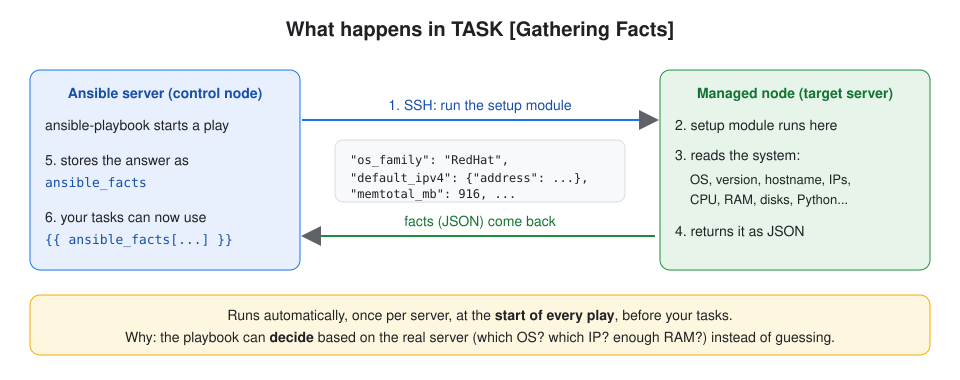
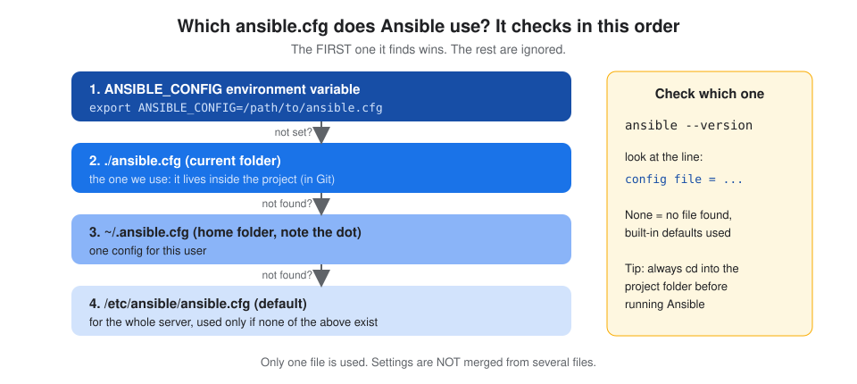
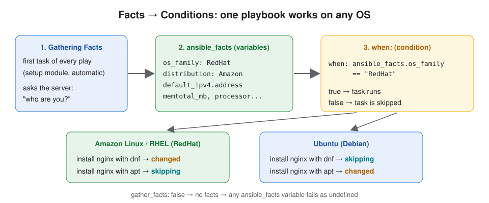
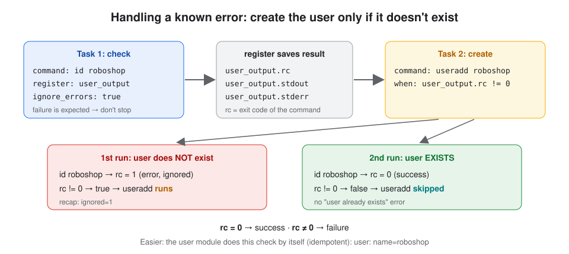

# Day 21 - Ansible Facts, Config Order, Data Types, Conditions, Loops, Filters & Error Handling

## About this class

In this class we make playbooks **smart**:

- read information about the server (**facts**)
- decide whether a task should run (**conditions**)
- repeat a task for many items (**loops**)
- change values (**filters**)
- handle commands that fail (**error handling**)

**What we cover:**

| Part | Topic |
|---|---|
| **Part 1: Concepts** | **facts** · which **ansible.cfg** is used · **data types** · **conditions** (`when`) · **loops** (`loop`) · **filters** · **error handling** (`register`, `rc`, `ignore_errors`) · **command vs shell** · **idempotency** |
| **Part 2: Lab** | security groups · project folder with `ansible.cfg` + inventory · one small playbook for each concept |

**Before this:** [Day 20 - Ansible Basics](../day-20-ansible-data-formats-yaml/README.md) (what Ansible is, inventory, playbooks, variables)

## Table of Contents

**Part 1: Concepts**
1. [Facts](#1-facts)
2. [ansible.cfg: which file is used?](#2-ansiblecfg-which-file-is-used)
3. [Data types](#3-data-types)
4. [Conditions (`when`)](#4-conditions-when)
5. [Loops (`loop`)](#5-loops-loop)
6. [Filters](#6-filters)
7. [Error handling](#7-error-handling)
8. [command vs shell](#8-command-vs-shell)
9. [Idempotency](#9-idempotency)

**Part 2: Lab**
- [Step 1: Security groups](#step-1-security-groups)
- [Step 2: Ansible server](#step-2-ansible-server)
- [Step 3: Create the project folder](#step-3-create-the-project-folder)
- [Step 4: Create ansible.cfg](#step-4-create-ansiblecfg)
- [Step 5: Create the inventory](#step-5-create-the-inventory)
- [Step 6: See which ansible.cfg is used](#step-6-see-which-ansiblecfg-is-used)
- [Step 7: Facts](#step-7-facts)
- [Step 8: Data types](#step-8-data-types)
- [Step 9: Condition: even or odd](#step-9-condition-even-or-odd)
- [Step 10: Condition: install nginx by OS](#step-10-condition-install-nginx-by-os)
- [Step 11: Loop over names](#step-11-loop-over-names)
- [Step 12: Loop to install packages](#step-12-loop-to-install-packages)
- [Step 13: Loop over a list of dictionaries](#step-13-loop-over-a-list-of-dictionaries)
- [Step 14: Filters](#step-14-filters)
- [Step 15: Error handling: create a user only if missing](#step-15-error-handling-create-a-user-only-if-missing)
- [Step 16: Idempotency: the same with one module](#step-16-idempotency-the-same-with-one-module)
- [Step 17: command vs shell](#step-17-command-vs-shell)
- [Step 18: Clean up](#step-18-clean-up)

[What I learned](#what-i-learned) · [Interview one-liners](#interview-one-liners)

---

# Part 1: Concepts

## 1. Facts

**Definition:** **Facts** = information Ansible **collects automatically** about a server (OS, IP, CPU, memory, disks…) and stores as **variables**.

**Gathering facts** = the step that collects them. It runs as the **first task of every play**, `TASK [Gathering Facts]`, even though you never wrote it.

### How it works



1. The play starts. Before your tasks, Ansible connects to the server.
2. It runs the **`setup`** module there.
3. `setup` reads the server **itself**: OS, version, hostname, IPs, CPU, RAM, disks.
4. The server sends this back to the Ansible server as **JSON**.
5. Ansible keeps it in a variable called **`ansible_facts`**.
6. Your tasks can use it: `{{ ansible_facts['os_family'] }}`.

**Facts are variables.** You use them like your own variables, but you don't write them: Ansible fills them in from the real server.

### Where are facts stored?

**In the Ansible server's memory (RAM), only while the playbook runs.** They are not saved to any file.

```
Playbook starts → Gathering Facts → kept in RAM → tasks use them → playbook ends → facts gone
Next run        → gathered again (always fresh)
```

Like a shell variable: it exists while the script runs, and is gone when the script ends.

> **Fact caching (optional):** with hundreds of servers, gathering facts every run is slow. You can save them to disk in `ansible.cfg`: `fact_caching = jsonfile`, `fact_caching_connection = /tmp/ansible_facts` (folder), `fact_caching_timeout = 86400` (1 day), and `gathering = smart` (reuse the saved facts).

### Why do we use facts?

A playbook usually runs on **many different servers**. Facts let it **look at each server and decide**, instead of you typing values by hand.

| Need | With facts |
|---|---|
| Install a package on Amazon Linux **and** Ubuntu with one playbook | `when: ansible_facts['os_family'] == "RedHat"` → `dnf`, `"Debian"` → `apt` |
| Put the server's private IP in a config file | `{{ ansible_facts['default_ipv4']['address'] }}` |
| Skip small servers | `when: ansible_facts['memtotal_mb'] > 1000` |

**In one line:** facts tell the playbook **"who is this server?"**

### Useful facts

| Fact | Example value |
|---|---|
| `ansible_facts['os_family']` | `RedHat`, `Debian` |
| `ansible_facts['distribution']` | `Amazon`, `Ubuntu` |
| `ansible_facts['default_ipv4']['address']` | `172.31.20.30` (private IP) |
| `ansible_facts['hostname']` | `ip-172-31-20-30` |
| `ansible_facts['memtotal_mb']` | `916` (RAM in MB) |
| `ansible_facts['processor_vcpus']` | `2` (CPUs) |

The same fact can be written in 2 styles: **bracket** `ansible_facts['default_ipv4']['address']` or **dot** `ansible_facts.default_ipv4.address`.

### Turning facts off

```yaml
- name: no facts needed
  hosts: local
  gather_facts: false
```

Faster (saves a few seconds per server), but any task that uses `ansible_facts` then **fails**.

## 2. ansible.cfg: which file is used?

**Definition:** **`ansible.cfg`** = Ansible's **settings file** (which inventory, which user, which key, how to print output…).

**Default location:** `/etc/ansible/ansible.cfg` (Linux keeps settings files in `/etc`).

But `ansible.cfg` can be in **4 places**. Ansible checks them in this **preference order** and uses the **first** one it finds:



| Order | Location | Means |
|---|---|---|
| **1** | `ANSIBLE_CONFIG` environment variable | always first: Ansible uses that file **from any folder** |
| **2** | `./ansible.cfg` | in the **current folder** (where you run the command) |
| **3** | `~/.ansible.cfg` | hidden file (note the dot) in your **home folder** |
| **4** | `/etc/ansible/ansible.cfg` | the **default**, used only if none of the above exist |

**Check which file is used:** `ansible --version` → the line `config file = ...`

**Best option: #2, the current folder.** Each project keeps its own `ansible.cfg` inside the project folder, saved in Git with the playbooks. You just `cd` into the project before running Ansible.

### Settings inside ansible.cfg

A setting is a `name=value` line under a **section** like `[defaults]`:

```ini
[defaults]
inventory=inventory.ini
callback_result_format=yaml
```

| Setting | Means |
|---|---|
| `inventory=inventory.ini` | which inventory file to use, so you **don't need `-i inventory.ini`** in every command |
| `callback_result_format=yaml` | print task results as **YAML**, easier to read than JSON |

| Without the setting | With the setting |
|---|---|
| `ansible-playbook -i inventory.ini 01-facts.yaml` | `ansible-playbook 01-facts.yaml` |

**Full list of settings:** `ansible-config init --disabled > ansible.cfg` creates a sample file with **every** setting. Lines starting with `#` are explanations. Lines starting with `;` are settings that are **off**. To switch one on, remove the `;` and give it a value.

> Older notes use `stdout_callback=yaml` for YAML output. On newer Ansible it fails with `Could not load 'yaml' callback plugin`. `callback_result_format=yaml` does the same and works on all current versions.

## 3. Data types

**Definition:** **Data type** = the **kind of value** a variable holds.

There are 5 basic types: **string, number, boolean, list, map/dictionary**. Ansible shows them with short names: `str`, `int`/`float` (a number is `int` if whole, `float` if decimal), `bool`, `list`, `dict`.

| Type | Ansible name | Example |
|---|---|---|
| String (text) | `str` | `course: "DevOps with AWS"` |
| Number (whole) | `int` | `duration_in_hrs: 150` |
| Number (decimal) | `float` | `duration_in_months: 4.5` |
| Boolean (true/false) | `bool` | `is_live: true` |
| List (many values) | `list` | `topics:` then `- Linux` and `- Shell` on new lines |
| Dictionary / map (key: value pairs) | `dict` | `details:` then `mode: online` and `months: 4` |

```yaml
topics:         # list: each item starts with "-"
- Linux
- Shell

details:        # dictionary: key: value
  mode: online
  months: 4
```

**See the type of a variable:** the `type_debug` filter prints it: `{{ course | type_debug }}` → `str`

> `duration: "4"` (in quotes) is a **string**. `duration: 4` is an **int**.

### Why do we need to know data types?

Each feature of Ansible needs the **right type**. With the wrong type, a task fails or gives a wrong answer:

| Feature | Needs | Wrong type → problem |
|---|---|---|
| Math / compare numbers (`%`, `>`) | **number** | `"7" % 2` fails (text can't do math). `"10" > "9"` is **false** (text is compared letter by letter) |
| `loop:` | **list** | loop runs over each item of the list |
| `item.name`, `item.state` | **dict** | only a dictionary has keys like `name` |
| `when: is_live` | **bool** | `true`/`false` decide if the task runs |

**So:** before using a variable, know its type. If it's the wrong type, convert it with a filter (`{{ "7" | int }}` → number). Check it with `type_debug`.

## 4. Conditions (`when`)

**Definition:** **Condition** = a check that decides **whether a task runs or not**. The keyword is **`when`**.

```yaml
- name: is even
  debug:
    msg: "{{ given_number }} is even"
  when: given_number % 2 == 0
```

- condition **true** → the task runs
- condition **false** → the task is **skipped** (`skipping`)

| Operator | Means | Example |
|---|---|---|
| `==` / `!=` | equal / not equal | `when: ansible_facts['os_family'] == "RedHat"` |
| `>` `<` `>=` `<=` | compare numbers | `when: ansible_facts['memtotal_mb'] > 1000` |
| `%` | remainder (even/odd) | `when: given_number % 2 == 0` |
| `and` / `or` / `not` | combine checks | `when: x > 1 and y < 5` |
| `is defined` | the variable exists | `when: person_name is defined` |

> **No `{{ }}` inside `when`.** Write `when: given_number % 2 == 0`.

**Facts + conditions = one playbook for any OS:**



## 5. Loops (`loop`)

**Definition:** **Loop** = run **the same task many times**, once for each item in a list. The keyword is **`loop`**.

**`item`** = a reserved word that holds the **current** value in each round.

```yaml
- name: print names
  debug:
    msg: "Hi {{ item }}"
  loop:
  - Ramesh
  - Suresh
  - Raheem
```

Output: `Hi Ramesh`, `Hi Suresh`, `Hi Raheem`: one task, 3 rounds.

| Way to give the list | Example | Read the value with |
|---|---|---|
| list under `loop:` | `- Ramesh`, `- Suresh` | `item` |
| a list variable | `loop: "{{ packages }}"` | `item` |
| a list of dictionaries | `- { name: 'nginx', state: 'absent' }` | `item.name`, `item.state` |

Without a loop you would copy the same task 5 times for 5 packages.

## 6. Filters

**Definition:** **Filter** = a built-in **function** that **changes a value**. Write it after a pipe **`|`**: `{{ value | filter }}`.

You can't write your own functions in a playbook. You use the filters Ansible gives you. (Custom filters must be written in Python.)

| Filter | Does | Example | Result |
|---|---|---|---|
| `default('x')` | use `x` if the variable is not defined | `{{ person_name \| default('Ramesh') }}` | `Ramesh` |
| `split(',')` | text → list | `{{ "a, b" \| split(',') }}` | `['a', ' b']` |
| `map('trim') \| list` | remove spaces from each item | `{{ "a, b" \| split(',') \| map('trim') \| list }}` | `['a', 'b']` |
| `join(' ')` | list → text | `{{ ['Ravi','Kumar'] \| join(' ') }}` | `Ravi Kumar` |
| `lower` / `upper` | change case | `{{ "ANSIBLE" \| lower }}` | `ansible` |
| `int` | text → number | `{{ "4" \| int }}` | `4` |
| `length` | count items | `{{ ['a','b'] \| length }}` | `2` |

Filters can be **chained**, and they run left to right.

## 7. Error handling

**Definition:** **Error handling** = deciding **what Ansible does when a task fails**.

By default, when a task fails, Ansible **stops** on that server.

| Error | What to do | Example |
|---|---|---|
| **Known** error (you expect it) | **handle it** | `id roboshop` fails when the user doesn't exist yet. That's normal, so keep going. |
| **Unknown** error (you didn't expect it) | **don't handle it, let it fail** | disk full, typo, package not found. You want to **see** these. |

**`rc` (return code)** = the number a Linux command returns when it finishes: **`0` = success**, anything else = **failure**.

| Keyword | Does |
|---|---|
| `register: user_output` | saves the task's result (`rc`, `stdout`, `stderr`) in a variable |
| `ignore_errors: true` | if this task fails, **don't stop**, go to the next task |
| `when: user_output.rc != 0` | uses the saved result to decide whether the next task runs |

**No module for it?** Use a Linux command with the `command` or `shell` module. Example: `id roboshop` checks whether a user exists.



## 8. command vs shell

**Definition:**
- **`command`** = runs one simple command **without a shell**.
- **`shell`** = runs the command **through a shell** (`/bin/sh`), so shell features work.

| | `command` | `shell` |
|---|---|---|
| Pipe `\|` | ❌ | ✅ `cat /etc/passwd \| grep ec2-user` |
| Redirect `>` | ❌ | ✅ `ls -la > /tmp/files.txt` |
| `&&`, `$HOME`, `*` | ❌ | ✅ |
| Safer | ✅ | less |
| Use when | a plain command is enough | you need `\|`, `>` or `&&` |

With `command`, `|` is **not** a pipe: it's passed to `cat` as a file name, so you get `cat: '|': No such file or directory`.

## 9. Idempotency

**Definition:** **Idempotency** = running the same playbook **again and again gives the same result**. If the server is already correct, Ansible **changes nothing**.

| Run | `user` module | `command: useradd roboshop` |
|---|---|---|
| 1st | creates the user → `changed` | creates the user |
| 2nd | user exists → `ok` (does nothing) | **fails**: `user 'roboshop' already exists` |

**Rule:** use a **module** when one exists, because it checks first. Use `command`/`shell` only when there's no module, and then add the check yourself (`register` + `when`), like in [Step 15](#step-15-error-handling-create-a-user-only-if-missing).

---

# Part 2: Lab

```
Step 1–2   security groups + Ansible server
Step 3–6   project folder, ansible.cfg, inventory, check the config
Step 7–17  one small playbook per concept
Step 18    clean up
```

All playbooks run on the **Ansible server itself** (`hosts: local` + `connection: local`), so **one server is enough**.

**Print test or real work?**

| Steps | Type | What they do |
|---|---|---|
| 7, 8, 9, 11, 14 | **print test** | use `debug` (Ansible's `echo`) to **print** values, just to **see how a feature works**. Nothing changes on the server |
| 10, 12, 13, 15, 16, 17 | **real work** | install/remove packages, create a user, write a file: what you'd do on real servers |

**How to create each playbook file:** `vim <file>` → press `i` → paste the YAML → `Esc` → `:wq` → `Enter`.
(If the pasted lines become a staircase, type `:set paste` before pressing `i`.)

### Step 1: Security groups

**Definition:** **Security group** = an AWS firewall for a server. **Inbound rule** = traffic that is allowed **in**.

| Security group | Port | From | Why | Attach to |
|---|---|---|---|---|
| `roboshop-common` | 22 (SSH) | **your IP only** | only you can log in | **every** server |
| `roboshop-frontend` | 80 (HTTP) | `0.0.0.0/0` (anyone) | users can open the website | the **frontend** server only |

Today only the Ansible server is needed, so it gets `roboshop-common`. A web server would get **both** groups.

Run these on your **laptop** (AWS CLI):

```bash
curl -s https://checkip.amazonaws.com
```

**What it does:** prints your laptop's public IP. Use it as `<your-ip>` below.

```bash
aws ec2 create-security-group --group-name roboshop-common --description "SSH from my IP"
```

```bash
aws ec2 authorize-security-group-ingress --group-name roboshop-common --protocol tcp --port 22 --cidr <your-ip>/32
```

**What it does:** allows SSH only from your IP (`/32` = exactly one IP).

```bash
aws ec2 create-security-group --group-name roboshop-frontend --description "HTTP for frontend"
```

```bash
aws ec2 authorize-security-group-ingress --group-name roboshop-frontend --protocol tcp --port 80 --cidr 0.0.0.0/0
```

**What it does:** allows HTTP from anywhere, only on servers that have this group.

**Expected:** a `GroupId` for each new group, and `"Return": true` for each rule. `InvalidGroup.Duplicate` or `InvalidPermission.Duplicate` = it already exists, which is fine.

### Step 2: Ansible server

Create one Amazon Linux EC2 server with the `roboshop-common` security group, log in, and install Ansible. The full commands are in [Day 20, Steps 2–3](../day-20-ansible-data-formats-yaml/README.md#step-2-create-the-ansible-server).

Check Ansible is installed:

```bash
ansible --version
```

**Expected:** `ansible [core 2.x.x]`

### Step 3: Create the project folder

```bash
mkdir ~/ansible-day21
```

**What it does:** creates a folder for this lab's files.

```bash
cd ~/ansible-day21
```

**Stay in this folder for the whole lab**, so Ansible finds its `ansible.cfg`.

### Step 4: Create ansible.cfg

```bash
vim ansible.cfg
```

Paste:

```ini
[defaults]
inventory=inventory.ini
callback_result_format=yaml
```

| Line | Means |
|---|---|
| `inventory=inventory.ini` | use `inventory.ini`, no `-i` needed |
| `callback_result_format=yaml` | show results as YAML |

### Step 5: Create the inventory

```bash
vim inventory.ini
```

Paste:

```ini
[local]
localhost
```

**What it means:** a group called `local` with one host, `localhost` (the Ansible server itself).

```bash
ansible-inventory --graph
```

**What it does:** shows the inventory as a tree. No `-i` needed, because `ansible.cfg` points to it.
**Expected:** `@local:` with `|--localhost` under it.

### Step 6: See which ansible.cfg is used

**Why:** to check that Ansible really uses **our** `ansible.cfg`, and to see the preference order working.

**6a. The project folder (#2 current folder)**

```bash
ansible --version
```

**Expected:** `config file = /home/ec2-user/ansible-day21/ansible.cfg`

**6b. The home folder**

```bash
cd ~
```

```bash
ansible --version
```

**Expected:** `config file = /etc/ansible/ansible.cfg` if the default file exists, otherwise `None`. The project's file is **not** used here.

**6c. `ANSIBLE_CONFIG` (#1) wins from any folder**

```bash
export ANSIBLE_CONFIG=/home/ec2-user/ansible-day21/ansible.cfg
```

**What it does:** sets the environment variable to the project's config file.

```bash
ansible --version
```

**Expected:** `config file = /home/ec2-user/ansible-day21/ansible.cfg`. You are in the home folder, but the environment variable comes first.

```bash
unset ANSIBLE_CONFIG
```

**What it does:** removes the variable again.

**6d. Go back to the project**

```bash
cd ~/ansible-day21
```

### Step 7: Facts

**Why:** **print test.** To see **what Ansible knows** about the server, and the exact fact names. In real playbooks you **use** these facts (Step 10), you don't print them.

When the play starts, Ansible **gathers the facts and stores them** in `ansible_facts`, but we **can't see them on screen**: `TASK [Gathering Facts]` only shows `ok`. **To see what it gathered, print it with `debug`.**

```bash
vim 01-facts.yaml
```

```yaml
- name: print facts
  hosts: local
  connection: local
  tasks:
  - name: print all facts
    debug:
      msg: "{{ ansible_facts }}"

  - name: print some info
    debug:
      msg: |
        OS Family: {{ ansible_facts['os_family'] }}
        private_ip: {{ ansible_facts.default_ipv4.address }}
        private_ip: {{ ansible_facts['default_ipv4']['address'] }}
```

| Line | Means |
|---|---|
| `hosts: local` | run on the `local` group from the inventory |
| `connection: local` | run directly on this server, no SSH |
| `msg: "{{ ansible_facts }}"` | print **all** facts (long, useful to find fact names) |
| `msg: \|` | a message with **several lines** |
| two `private_ip` lines | the same fact in **dot** and **bracket** style |

```bash
ansible-playbook 01-facts.yaml
```

**Expected:** a long list of facts, then `OS Family: RedHat` and the server's private IP **twice** (both styles give the same value).

> In real playbooks we don't print facts, we **use** them (for example in `when:`). Printing is only to learn the names and check the values.

### Step 8: Data types

**Why:** **print test.** To see the 5 types and how Ansible names them. It matters later: loops need a **list**, `item.name` needs a **dict**, and math like `%` needs a **number**, not text (Step 9).

```bash
vim 02-data-types.yaml
```

```yaml
- name: course information
  hosts: local
  connection: local
  vars:
    course: "DevOps with AWS"   # string
    duration_in_hrs: 150        # number
    is_live: true               # boolean
    topics:                     # list
    - Linux
    - Shell
    - Ansible
    details:                    # dictionary
      mode: online
      months: 4
    duration_in_months: 4.5     # decimal number
  tasks:
  - name: print each value and its type
    debug:
      msg: |
        course: {{ course }} : {{ course | type_debug }}
        duration: {{ duration_in_hrs }} : {{ duration_in_hrs | type_debug }}
        is live: {{ is_live }} : {{ is_live | type_debug }}
        topics: {{ topics }} : {{ topics | type_debug }}
        details: {{ details }} : {{ details | type_debug }}
        months: {{ duration_in_months }} : {{ duration_in_months | type_debug }}
```

| Line | Means |
|---|---|
| `vars:` | 6 variables, one of each type |
| `{{ course }}` | prints the **value** |
| `{{ course \| type_debug }}` | prints the **type** of that value |

```bash
ansible-playbook 02-data-types.yaml
```

**Expected:**

```
course: DevOps with AWS : str
duration: 150 : int
is live: True : bool
topics: ['Linux', 'Shell', 'Ansible'] : list
details: {'mode': 'online', 'months': 4} : dict
months: 4.5 : float
```

### Step 9: Condition: even or odd

**Why:** **print test.** A simple way to practise `when` with numbers. Real use: run a task only in some cases (only on RedHat, only if a user is missing…).

```bash
vim 03-even-odd.yaml
```

```yaml
- name: even or odd
  hosts: local
  connection: local
  vars:
    given_number: 10
  tasks:
  - name: is even
    debug:
      msg: "{{ given_number }} is even"
    when: given_number % 2 == 0

  - name: is odd
    debug:
      msg: "{{ given_number }} is odd"
    when: given_number % 2 != 0
```

```bash
ansible-playbook 03-even-odd.yaml
```

**Expected:** `is even` → `10 is even`. `is odd` → `skipping`. Recap: `skipped=1`.

Now try an odd number:

```bash
ansible-playbook 03-even-odd.yaml -e '{"given_number": 7}'
```

**Expected:** `is even` is skipped, `is odd` prints `7 is odd`.

> **Why this format?** `-e given_number=7` passes `"7"` as **text**, and `%` on text fails with `not all arguments converted during string formatting`. The `'{"given_number": 7}'` form keeps it a **number**.

### Step 10: Condition: install nginx by OS

**Why:** **real use.** One playbook installs nginx on **any** OS: a fact (`os_family`) + `when` picks `dnf` or `apt`.

```bash
vim 04-install-by-os.yaml
```

```yaml
- name: install nginx on any OS
  hosts: local
  connection: local
  become: yes
  tasks:
  - name: install nginx on RedHat family
    dnf:
      name: nginx
      state: present
    when: ansible_facts['os_family'] == "RedHat"

  - name: install nginx on Debian family
    apt:
      name: nginx
      state: present
    when: ansible_facts['os_family'] == "Debian"
```

| Line | Means |
|---|---|
| `become: yes` | run as root (sudo), needed to install packages |
| `dnf:` / `apt:` | package module for RedHat family / Debian family |
| `when: ansible_facts['os_family'] == ...` | a **fact** picks the right task |

```bash
ansible-playbook 04-install-by-os.yaml
```

**Expected (Amazon Linux is RedHat family):** the RedHat task → `changed`, the Debian task → `skipping`.

### Step 11: Loop over names

**Why:** **print test.** The simplest way to see how `loop` and `item` work.

```bash
vim 05-loop-names.yaml
```

```yaml
- name: loop demo
  hosts: local
  connection: local
  tasks:
  - name: print names
    debug:
      msg: "Hi {{ item }}"
    loop:
    - Ramesh
    - Suresh
    - Raheem
```

```bash
ansible-playbook 05-loop-names.yaml
```

**Expected:** one task with 3 results:

```
ok: [localhost] => (item=Ramesh)   msg: Hi Ramesh
ok: [localhost] => (item=Suresh)   msg: Hi Suresh
ok: [localhost] => (item=Raheem)   msg: Hi Raheem
```

### Step 12: Loop to install packages

**Why:** **real use.** Install many packages with **one** task instead of writing one task per package.

```bash
vim 06-loop-packages.yaml
```

```yaml
- name: install packages
  hosts: local
  connection: local
  become: yes
  vars:
    packages:
    - git
    - tree
    - unzip
  tasks:
  - name: install packages
    package:
      name: "{{ item }}"
      state: present
    loop: "{{ packages }}"
```

| Line | Means |
|---|---|
| `packages:` | a **list variable** |
| `package:` | uses `dnf` or `apt` automatically |
| `loop: "{{ packages }}"` | loop over the variable (needs quotes and `{{ }}`) |

```bash
ansible-playbook 06-loop-packages.yaml
```

**Expected:** one line per package: `changed`, or `ok` if it was already installed.

### Step 13: Loop over a list of dictionaries

**Why:** **real use.** Give each item more than one value (`name` + `state`), so one task can install some packages and remove others.

Each item has a **name** and a **state**, so one task can install some packages and remove others.

```bash
vim 07-loop-dict.yaml
```

```yaml
- name: install or remove packages
  hosts: local
  connection: local
  become: yes
  vars:
    packages:
    - { name: 'git', state: 'present' }
    - { name: 'tree', state: 'absent' }
    - { name: 'nginx', state: 'absent' }
  tasks:
  - name: install or remove packages
    package:
      name: "{{ item.name }}"
      state: "{{ item.state }}"
    loop: "{{ packages }}"
```

| Line | Means |
|---|---|
| `{ name: 'git', state: 'present' }` | each item is a **dictionary** with 2 keys |
| `item.name` / `item.state` | read one key from the current item |
| `present` / `absent` | install / remove |

```bash
ansible-playbook 07-loop-dict.yaml
```

**Expected:** `git` → `ok` (already installed), `tree` and `nginx` → `changed` (removed).

### Step 14: Filters

**Why:** **print test** of the most used filters. Real use: give a **default** when a variable is missing, convert **text → number** before comparing, turn a list into one line of text.

```bash
vim 08-filters.yaml
```

```yaml
- name: filters demo
  hosts: local
  connection: local
  vars:
    topics: Linux, Shell, Ansible, Terraform
    names:
    - Ravi
    - Kumar
    - Reddy
    topic: ANSIBLE
    duration: "4"
  tasks:
  - name: default value
    debug:
      msg: "Hi, {{ person_name | default('Ramesh') }}"

  - name: text to list
    debug:
      msg: "Topics: {{ topics | split(',') | map('trim') | list }}"

  - name: list to text
    debug:
      msg: "Full name: {{ names | join(' ') }}"

  - name: lower case
    debug:
      msg: "Topic: {{ topic | lower }}"

  - name: text to number
    debug:
      msg: "Duration: {{ duration | int }} : {{ duration | int | type_debug }}"
```

```bash
ansible-playbook 08-filters.yaml
```

**Expected:**

| Task | Output |
|---|---|
| default value | `Hi, Ramesh` (`person_name` is not defined) |
| text to list | `Topics: ['Linux', 'Shell', 'Ansible', 'Terraform']` |
| list to text | `Full name: Ravi Kumar Reddy` |
| lower case | `Topic: ansible` |
| text to number | `Duration: 4 : int` |

Now give a name:

```bash
ansible-playbook 08-filters.yaml -e person_name=Suresh
```

**Expected:** `Hi, Suresh`. The variable exists, so `default` isn't used.

> `split(',')` keeps the space after each comma (`' Shell'`). `map('trim')` removes it from every item.

### Step 15: Error handling: create a user only if missing

**Why:** **real use.** Running `useradd` twice fails ("user already exists"). So we **check first** and create the user **only if it's missing**. The same check is used in real app setups (a `roboshop` user for the app).

There's no simple module to just **check** whether a user exists, so we use the Linux command `id`. It fails (`rc` not 0) when the user is missing. That's a **known** error, so we handle it.

```bash
vim 09-error-handling.yaml
```

```yaml
- name: create user if missing
  hosts: local
  connection: local
  become: yes
  tasks:
  - name: check if roboshop user exists
    command: id roboshop
    register: user_output
    ignore_errors: true

  - name: print the result
    debug:
      msg: "{{ user_output }}"

  - name: create user
    command: useradd roboshop
    when: user_output.rc != 0
```

| Line | Means |
|---|---|
| `command: id roboshop` | check: does the user exist? |
| `register: user_output` | save the result (`rc`, `stdout`, `stderr`) |
| `ignore_errors: true` | user missing = known error, don't stop |
| `when: user_output.rc != 0` | create the user **only if** the check failed |

**1st run:**

```bash
ansible-playbook 09-error-handling.yaml
```

**Expected:**
- check task: red `FAILED` with `rc: 1` and `no such user`, then `...ignoring`
- create user → `changed`
- recap: `failed=0` `ignored=1`

**2nd run:**

```bash
ansible-playbook 09-error-handling.yaml
```

**Expected:** check task `rc: 0` (the user exists now) → create user is **skipping**. No "already exists" error.

### Step 16: Idempotency: the same with one module

**Why:** **real use, the right way.** Same result as Step 15 with one module, because the module checks by itself.

The `user` module checks by itself, so one task does what Step 15 did in three.

```bash
vim 10-idempotency.yaml
```

```yaml
- name: create user with a module
  hosts: local
  connection: local
  become: yes
  tasks:
  - name: create user
    user:
      name: roboshop
```

```bash
ansible-playbook 10-idempotency.yaml
```

**Expected:** `ok`, because the user already exists from Step 15, so nothing changes. On a new server the first run is `changed`, and every run after that is `ok`.

### Step 17: command vs shell

**Why:** to see **when you need `shell`**: commands with a pipe `|` or redirect `>` only work with `shell`.

```bash
vim 11-shell.yaml
```

```yaml
- name: shell demo
  hosts: local
  connection: local
  tasks:
  - name: pipe needs shell
    shell: cat /etc/passwd | grep ec2-user
    register: passwd_output

  - name: print the output
    debug:
      msg: "{{ passwd_output.stdout }}"

  - name: redirect needs shell
    shell: ls -la > /tmp/files.txt
```

```bash
ansible-playbook 11-shell.yaml
```

**Expected:** the `ec2-user` line from `/etc/passwd` is printed.

```bash
cat /tmp/files.txt
```

**Expected:** the file list that the playbook saved with `>`.

**Now see `command` fail:** open the file again, change the **first** `shell:` to `command:`, and run it.

```bash
ansible-playbook 11-shell.yaml
```

**Expected:** `FAILED` with `cat: '|': No such file or directory`. `command` doesn't understand `|`.

### Step 18: Clean up

```bash
sudo userdel -r roboshop
```

**What it does:** deletes the test user (`-r` also deletes its home folder).

When you're finished, terminate the EC2 server from your laptop or the AWS console, so it doesn't keep costing money.

---

## What I learned

| Topic | One line |
|---|---|
| Facts | each server sends its own info (OS, IP, RAM) as JSON. It's kept in RAM only during the run |
| ansible.cfg | `ANSIBLE_CONFIG` → `./ansible.cfg` → `~/.ansible.cfg` → `/etc/ansible/ansible.cfg`, first one wins. Best: keep it in the project folder |
| Data types | `str`, `int`, `float`, `bool`, `list`, `dict`. Check with `type_debug` |
| Conditions | `when:` runs the task only if true, otherwise `skipping` |
| Loops | `loop:` runs one task per item. The current value is `item` |
| Filters | Ansible's functions after `\|`: `default`, `split`, `join`, `lower`, `int` |
| Error handling | handle **known** errors (`register` + `ignore_errors` + `when rc != 0`), let **unknown** ones fail |
| command vs shell | `shell` supports `\|` `>` `&&`. `command` doesn't |
| Idempotency | modules check first and change only what's needed. Commands don't |

```
Gathering Facts ──► when: (condition) ──► loop: (repeat) ──► register + rc (check result) ──► module = idempotent
```

## Interview one-liners

| Question | Answer |
|---|---|
| What are facts? | System info (OS, IP, CPU, memory) that Ansible gathers from each host with the `setup` module before running tasks. |
| Where are facts stored? | In the control node's memory, only for that run. On disk only with fact caching (`fact_caching = jsonfile`). |
| How do you disable facts? | `gather_facts: false` in the play. Faster, but `ansible_facts` can't be used. |
| ansible.cfg precedence? | `ANSIBLE_CONFIG` → `./ansible.cfg` → `~/.ansible.cfg` → `/etc/ansible/ansible.cfg`. First one found wins. |
| How do you write a condition? | With `when:` and no `{{ }}`, e.g. `when: ansible_facts['os_family'] == "RedHat"`. |
| How do you loop? | `loop:` with a list. The current value is `item` (`item.name` for a list of dictionaries). |
| What is a filter? | A function applied with `\|`, e.g. `{{ name \| default('x') }}`, `{{ list \| join(',') }}`. |
| What does `register` do? | Saves a task's result (`rc`, `stdout`, `stderr`) in a variable for later tasks. |
| What is `rc`? | The command's return code: `0` = success, anything else = failure. |
| When to use `ignore_errors`? | Only for **expected** failures. Unknown errors should fail so you notice them. |
| command vs shell? | `command` has no shell (no pipes/redirects, safer). `shell` runs in `/bin/sh`, so `\|`, `>`, `&&` work. |
| What is idempotency? | Running the same playbook again changes nothing if the server is already correct. Modules do this, `command`/`shell` don't. |
